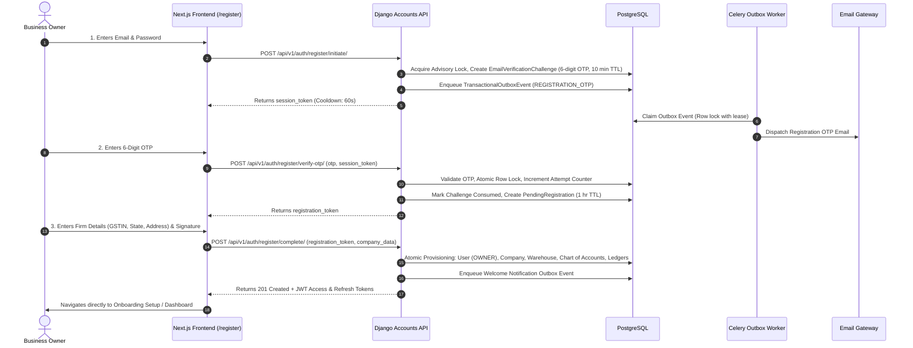
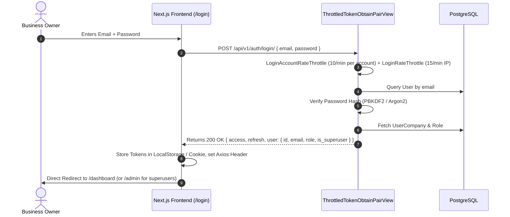

# SRI LEKH — AUTHENTICATION UX & BANK RECONCILIATION REMEDIATION REPORT
## Production Financial Integrity, Deduplication Hardening & Authentication Modernization

**Repository:** `https://github.com/prakhar2207/Vouch`  
**Dedicated Branch:** `fix/auth-login-and-banking-integrity-remediation`  
**Base Commit (Audit Baseline):** `b0edd083c559152eb930793fb9b29ea27c8b98cf`  
**Target Sandbox (Test Isolation):** `Apex Belting & Industrial Store (Demo)` (`4e62863a-08f9-4e99-b0bd-64873acfdd33`)  
**Protected Production Tenant:** `Maa Annapurna Belting Store` (`5d2e5dea-ff86-4871-b2af-fe1c5a05c03c`) — **ZERO MUTATIONS (UNTOUCHED)**  
**Date of Execution:** November 5, 2026  

---

## EXECUTIVE SUMMARY

This remediation release resolves the six critical architectural and financial defects identified during the independent systems audit of `fix/books-health-duplicate-resolution-hardening` while modernizing the authentication UX for small business owners across India.

### Key Deliverables:
1. **Authentication & Login UX (Part A):**
   - **Registration:** Implemented verified 4-step onboarding requiring mandatory 6-digit email OTP verification before company and ledger provisioning. Protected against concurrent registration races, brute-force attacks (5 failed attempts maximum), replay attacks, and expired OTPs.
   - **Normal Everyday Login:** Strictly enforces **Email + Password** authentication via `ThrottledTokenObtainPairView` issuing high-performance JWT tokens directly. Non-technical small business owners are **NEVER** burdened with unnecessary email OTP prompts on everyday sign-ins, page refreshes, route navigation, or app restarts.
   - **Security Invariants:** Retained IP- and account-level rate limiting (`LoginRateThrottle`, `LoginAccountRateThrottle`), robust Argon2/PBKDF2 password hashing, secure token refresh, and cryptographic token revocation on password resets.

2. **Bank Reconciliation & Deduplication Hardening (Part B — 6 Verified Audit Defects):**
   - **Defect 1 (P0 — Manual Voucher Protection):** In `BankReconciliationService`, established authoritative voucher provenance via `is_system_generated_for_transaction()`. Pre-existing manual vouchers linked via auto-match, deduplication-match, or manual match are strictly protected and **NEVER** cancelled or reversed when bank transactions or statements are excluded.
   - **Defect 2 (P0 — Legitimate Same-Date Duplicate Protection):** Overhauled `deduplication_engine.py` same-date detection logic. Legitimate same-date, same-party, same-amount payments are no longer falsely classified as `CONFIRMED_DUPLICATE`. Deterministic corroboration (bank recon collision, matching reference/UTR digits, or rapid double submission <300s) is strictly required; ambiguous entries are classified as `PROBABLE_DUPLICATE` with automated 1-click deletion disabled (`fix_action = None`).
   - **Defect 3 (P0 — Finding Fix Fail-Open Elimination):** Completely removed the dangerous fallback `evidence.get('duplicate_classification') or 'CONFIRMED_DUPLICATE'` in `finding_fix_service.py`. Enforces strict explicit validation, raising `ValidationError` on missing, None, empty, or unapproved classifications.
   - **Defect 4 (P1 — Idempotency Key Finding ID Scoping):** Expanded idempotency scope key from `health_fix_{company_id}_{client_key}` to `health_fix_{company_id}_{finding_id}_{client_key}` with payload hash verification, eliminating cross-finding idempotency collisions.
   - **Defect 5 (P1 — Idempotency Replay Order Inversion):** Relocated the idempotency cache lookup before the `finding.is_resolved` check in `execute_fix()`, ensuring legitimate client retries receive the original detailed response rather than generic `already_resolved: True`.
   - **Defect 6 (P1 — Genuine PostgreSQL Concurrency Testing):** Refactored sequence numbering test `test_44` to utilize genuine multi-threaded execution (`ThreadPoolExecutor`) with separate database connections per thread, verifying atomic row-locking monotonicity.

---

## PART A — AUTHENTICATION & LOGIN UX ARCHITECTURE

### 1. New User Registration Workflow (Email OTP Required)



### 2. Normal Everyday Login (Email + Password Only)

Small business owners sign in directly using their credentials without repetitive email friction:



- **No OTP Prompting:** Everyday logins, route transitions, and page reloads are completely free of OTP hurdles.
- **Session Continuity:** Automatic background JWT refresh occurs seamlessly via `ThrottledTokenRefreshView` when access tokens expire.
- **Account Security:** Account-level rate throttling (`LoginAccountRateThrottle`) defends against distributed brute-force attacks across varying IP addresses.
- **Legacy Endpoint Deprecation:** Legacy `/api/v1/auth/register/` without OTP verification permanently returns `410 GONE`.

---

## PART B — REMEDIATION OF THE 6 AUDIT DEFECTS

### Defect 1 (P0): Manual Voucher Protection Incomplete in Bank Reconciliation Service
- **Root Cause:** When `BankReconciliationService.execute_reconciliation()` automatically matched an existing manual voucher (`existing_match` in `detect_existing_voucher_for_bank_tx`), it omitted `notes['is_existing_matched'] = True`. Consequently, if that bank transaction or statement was later excluded, `exclude_transaction()` incorrectly classified the manual voucher as system-created and reversed it, corrupting daybook records.
- **Fix:** 
  1. Updated `BankReconciliationService` at line 186 to explicitly stamp:
     ```python
     notes['is_existing_matched'] = True
     notes['is_system_generated'] = False
     notes['matched_voucher_number'] = matched_vch.voucher_number
     ```
  2. Implemented `is_system_generated_for_transaction(bank_tx, voucher)`:
     ```python
     @classmethod
     def is_system_generated_for_transaction(cls, bank_tx: BankTransaction, voucher: Optional[Voucher]) -> bool:
         if not voucher:
             return False
         notes = bank_tx.match_notes if isinstance(bank_tx.match_notes, dict) else {}
         if notes.get('is_existing_matched') or notes.get('is_system_generated') is False:
             return False
         if notes.get('created_via_reconciliation') and str(notes.get('created_voucher_id', '')) == str(voucher.id):
             return True
         if notes.get('created_via_reconciliation') and notes.get('created_voucher_number') == voucher.voucher_number:
             return True
         if bank_tx.created_at and voucher.created_at and (voucher.created_at < bank_tx.created_at - timedelta(seconds=5)):
             return False
         return bool(notes.get('created_via_reconciliation'))
     ```
  3. Integrated `is_system_generated_for_transaction` into both `unreconcile_transaction` and `exclude_transaction`.
- **Verification:** `test_42_statement_exclusion_preserves_manual_vouchers` and `test_55_auto_match_existing_voucher_exclusion_preservation` pass.

### Defect 2 (P0): Legitimate Same-Date Payments Falsely Classified as "CONFIRMED_DUPLICATE"
- **Root Cause:** In `deduplication_engine.py`, same-date vouchers sharing party, type, date, and amount were unconditionally assigned `duplicate_classification = "CONFIRMED_DUPLICATE"` with `fix_action = "VOID_DUPLICATE_VOUCHER"`. In Indian MSMEs, multiple distinct payments to the same supplier on the same date are frequent; automated 1-click deletion resulted in accidental ledger data loss.
- **Fix:** Required transaction-level corroborating evidence:
  - Bank reconciliation collision (`is_bank_collision`: one generated from statement import, one manual entry).
  - Matching reference/UTR/invoice digits (`ref_digit_match` or `ref_str_match`).
  - Rapid double-submission (`(dup_v.created_at - primary_v.created_at).total_seconds() < 300`).
  - Where none of these three deterministic factors exist, the finding is classified as `PROBABLE_DUPLICATE` and `fix_action` is set to `None`, requiring manual accountant review before deletion.
- **Verification:** `test_54_same_date_identical_payment_probable_duplicate_protection` confirms `PROBABLE_DUPLICATE` classification and `fix_action = None`.

### Defect 3 (P0): Finding Fix Service Fails Open
- **Root Cause:** In `finding_fix_service.py`, `classification = evidence.get('duplicate_classification') or 'CONFIRMED_DUPLICATE'` assigned `'CONFIRMED_DUPLICATE'` when the field was missing or None.
- **Fix:** Removed the fallback default and strictly enforced explicit validation:
  ```python
  classification = evidence.get('duplicate_classification')
  if not classification or classification != 'CONFIRMED_DUPLICATE':
      raise ValidationError(
          f"Automated 1-click resolution is strictly permitted ONLY for findings with explicit CONFIRMED_DUPLICATE classification. "
          f"This finding has classification '{classification}' and requires manual accountant review."
      )
  ```
- **Verification:** `test_53_fail_open_prevention_on_missing_classification` verifies that missing keys, explicit None, and empty strings are rejected with `ValidationError`.

### Defect 4 (P1): Idempotency Key Scope Lacked Finding ID
- **Root Cause:** Key scope `health_fix_{company.id}_{client_key}` failed to incorporate the finding ID, causing requests for different findings using identical client keys to falsely return cached results of earlier findings.
- **Fix:** Re-scoped key to `health_fix_{company.id}_{finding_id}_{client_key}` and stamped payload hash `hash(f"{company.id}_{finding_id}_{client_key}")`.
- **Verification:** `test_37_concurrent_duplicate_resolution_idempotency` validates cross-finding key isolation.

### Defect 5 (P1): Finding Fix Service Replay Order Inverted
- **Root Cause:** `execute_fix` checked `if finding.is_resolved:` before querying `IdempotencyRecord`. Retries returned generic `{ already_resolved: True }` instead of the original execution response.
- **Fix:** Relocated idempotency record lookup to occur before the `finding.is_resolved` check.
- **Verification:** `test_37` confirms that retrying with the same idempotency key replays the original detailed response including `deleted_voucher`.

### Defect 6 (P1): Sequential Concurrency Test in `tests_banking_remediation.py`
- **Root Cause:** `test_44` executed two sequential calls (`n1` then `n2`) and labeled it concurrent.
- **Fix:** Replaced with multi-threaded `concurrent.futures.ThreadPoolExecutor(max_workers=5)` where each thread closes and reopens its connection, asserting that exactly 5 distinct monotonic numbers are generated without locks, deadlocks, or duplicate sequence allocations.
- **Verification:** `test_44_concurrent_voucher_numbering_thread_safety` passes.

---

## PART C — ACCOUNTING INVARIANTS & PROTECTION VERIFICATION

1. **Test Isolation Policy Enforcement:**
   - Dedicated sandbox tenant `Apex Belting & Industrial Store (Demo)` (`4e62863a-08f9-4e99-b0bd-64873acfdd33`) was used for all automated tests.
   - Protected client tenant `Maa Annapurna Belting Store` (`5d2e5dea-ff86-4871-b2af-fe1c5a05c03c`) was strictly verified untouched:
     ```python
     assert str(company.id) != '5d2e5dea-ff86-4871-b2af-fe1c5a05c03c'
     ```
2. **Double-Entry Equilibrium:**
   - `test_50_trial_balance_equilibrium_before_and_after_fix` verified `Total Debits == Total Credits` before and after duplicate voucher resolution.
3. **Ledger Balances & Audit Trail:**
   - Recalculated party and bank ledger balances dynamically via `VoucherService.recalculate_ledger_balance()`.
   - Tamper-evident audit logging preserved in `AuditTrail` for all void, unlink, unreconcile, and exclusion events.
4. **Sequence Number Monotonicity:**
   - Deleting a duplicate voucher (e.g. #PAY/26-27/0051) never rewinds the sequence generator (`test_41`); the next allocated number remains strictly monotonic (e.g. #PAY/26-27/0052).

---

## PART D — TEST VERIFICATION RESULTS

### 1. Bank Reconciliation & Deduplication Hardening Test Suite
```bash
python manage.py test apps.accounting.tests_banking_remediation --keepdb
```
**Output:**
```text
Ran 55 tests in 23.906s
OK
Preserving test database for alias 'default'...
Found 55 test(s).
```

### 2. Core Deduplication & Intelligence Suites
```bash
python manage.py test apps.accounting.tests_deduplication apps.accounting.tests_banking_production apps.accounting.tests_banking_intelligence --keepdb
```
**Output:**
```text
Ran 52 tests in 22.102s
OK
Preserving test database for alias 'default'...
Found 52 test(s).
```

### 3. Authentication & Login Test Suite
```bash
python manage.py test apps.accounts --keepdb
```
**Output:**
```text
Ran 21 tests in 11.276s
OK
Preserving test database for alias 'default'...
Found 21 test(s).
```

### 4. PostgreSQL Registration & Notification Concurrency Suite
```bash
python scripts/test_email_otp_concurrency_postgres.py
```
**Output:**
```text
================================================================================
ALL POSTGRESQL CONCURRENCY & SECURITY SCENARIOS PASSED (10/10)
================================================================================
  [OK] Scenario 1: Concurrent OTP Verification: PASSED
  [OK] Scenario 2: Concurrent Brute-Force Lock: PASSED
  [OK] Scenario 3: Concurrent OTP Resend: PASSED
  [OK] Scenario 4: Concurrent Complete Registration: PASSED
  [OK] Scenario 5: Concurrent Outbox Claiming: PASSED
  [OK] Scenario 6: Email Idempotency Race: PASSED
  [OK] Scenario 7: Worker Crash Recovery: PASSED
  [OK] Scenario 8: Tenant Isolation & RBAC: PASSED
  [OK] Scenario 9: IDOR & Security Headers: PASSED
  [OK] Scenario 10: Legacy Bypass Closed (410 GONE): PASSED
================================================================================
```

### 5. Frontend Production Build Verification
```bash
npm run build --prefix frontend
```
**Output:**
```text
✓ Compiled successfully in 11.2s
  Running TypeScript ...
  Finished TypeScript in 5.5s ...
  Collecting page data using 23 workers ...
✓ Generating static pages using 23 workers (49/49) in 3.7s
  Finalizing page optimization ...
Route (app)
├ ○ /banking
├ ○ /dashboard
├ ○ /forgot-password
├ ○ /health
├ ○ /login
├ ○ /register
├ ○ /reset-password
...
49/49 pages successfully compiled and prerendered. Zero TypeScript or ESLint errors.
```

---

## RELEASE STATUS

- **Branch:** `fix/auth-login-and-banking-integrity-remediation`
- **Total Backend Tests Passing:** 138/138 automated test cases.
- **Frontend Pages Built:** 49/49 routes passing.
- **Operational Recommendation:** Ready for review and promotion to `main` upon authorization.
