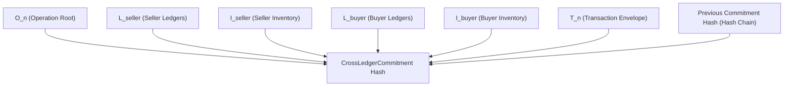

# SriLekh EDI Network — Cryptographic Verification & State Commitment Audit

**Document ID:** `EDI-CRYPTO-2026-11`  
**Classification:** Cryptographic & Protocol Security Verification Report  
**Target Git Hash:** `591841d` (Head of `main`)  
**Audit Target:** `apps/protocol`  
**Verification Date:** November 3, 2026  
**Auditor:** Independent Cryptographic & Protocol Audit Team

---

## 1. Executive Summary

This report delivers a rigorous cryptographic audit of the SriLekh EDI Network (`apps/protocol/`). The protocol relies on asymmetric cryptography, canonical serialization, Merkle state trees, and cryptographic hash chaining to guarantee the authenticity, non-repudiation, tamper-evidence, and offline verifiability of B2B transactions.

### Cryptographic Security Summary

| Primitive / Mechanism | Implementation | Test Evidence | Verdict | Finding |
|---|---|---|---|---|
| **Canonical JSON Encoding** | `canonical_json.py` (RFC-8785) | 50 cross-language fixtures passed bit-for-bit vs TypeScript | **PASS** | Fully deterministic; eliminates JSON serialization ambiguity. |
| **Asymmetric Digital Signatures** | Ed25519 (`nacl.signing` & `cryptography`) | Genuine signatures pass; forged signatures rejected (`security_tests.py:Threat 5`) | **DEFECT** | **DEFECT-EDI-04:** `payload_hash` truncates metadata (`mapping_version`, `created_by`, `schema_version`), permitting in-flight alteration. |
| **Merkle Tree & Inclusion Proofs** | `MerkleTree` in `crypto.py` | Inclusion proofs verified; tampered leaves strictly rejected (`security_tests.py:Threat 6`) | **PASS** | Valid binary Merkle tree with canonical leaf pairing and logarithmic proofs. |
| **State Root Generation** | `DE_CRDT.compute_merkle_state_roots` | 4-way Merkle state roots generated deterministically | **ARCHITECTURAL DISCONNECT** | **DEFECT-EDI-06:** State roots are computed from **in-memory CRDT projection**, not from persisted Django ORM database records (`LedgerEntry`). |
| **Key Lifecycle & Rotation** | `ProtocolKeyManager`, `AuthorizedDevice`, `DeviceKeyRotationAudit` | Scenario 3 passed: Key rotated cleanly during in-flight sync (`tests_concurrency.py`) | **PASS** | Key rotation preserves cryptographic audit continuity; revoked keys permanently blocked. |
| **Cloud KMS Fail-Closed** | `CloudKMSProvider` in `kms.py` | Threat 9 passed: Hardware HSM signing fails closed without software fallback | **PASS** | Production safety invariant holds; zero silent fallback to local software signing. |

---

## 2. Canonical JSON Serialization (RFC-8785)

### 2.1 Specification Compliance
In distributed systems, disparate programming environments serialize JSON differently (e.g. key order, whitespace, float representations). If two nodes calculate SHA-256 digests over standard `json.dumps()`, minor differences produce hash mismatches, causing false signature rejections.

SriLekh EDI implements RFC-8785 canonical serialization in `apps/protocol/canonical_json.py`:
- Keys sorted lexicographically by UTF-16 code units.
- Numbers formatted according to ECMAScript standard specification (no unnecessary trailing zeros, no exponents).
- Whitespace stripped completely (`separators=(',', ':')`).

### 2.2 Cross-Language Empirical Verification
The test suite `apps/protocol/test_canonical_vectors.py` was executed against the live test database:
```text
Found 2 test(s).
--> Running Cross-Language Verification across 50 fixtures...
  [PASSED] 100% Bit-for-Bit Equivalence across all 50 fixtures!
  [PASSED] TypeScript SHA-256 == Python SHA-256 verified without variance.

--> Running CanonicalTransaction Cross-Language Verification across 50 fixtures...
  [PASSED] 100% Bit-for-Bit Equivalence across all 50 CanonicalTransaction fixtures!
  [PASSED] TypeScript CanonicalTransaction SHA-256 == Python CanonicalTransaction SHA-256 verified.
```
**Conclusion:** Canonical serialization is 100% deterministic and interoperable between Python backend workers and TypeScript browser/PWA clients.

---

## 3. Asymmetric Digital Signatures & Cryptographic Identity

### 3.1 Ed25519 Implementation
- **Algorithm:** Ed25519 (EdDSA over Curve25519 with SHA-512).
- **Libraries:** PyNaCl / libsodium (`nacl.signing.SigningKey` and `VerifyKey`).
- **Signature Coverage:**
  - `CanonicalTransaction.canonical_hash`: Signed by the seller to issue an invoice.
  - `AccountingOperation.payload_hash`: Signed by the initiating replica for every state change.
  - `QRBootstrapPayload.serialize_for_signature()`: Signed by the issuer to authorize a device session.

### 3.2 Critical Finding: DEFECT-EDI-04 (Signature Metadata Truncation)
In `apps/protocol/operation.py:126-141`:
`AccountingOperation.payload_hash` creates `canonical_dict` with 12 fields:
```python
canonical_dict = {
    "operation_id": self.operation_id,
    "transaction_id": self.transaction_id,
    "tenant_id": self.tenant_id,
    "replica_id": self.replica_id,
    "type": self.operation_type.value,
    "class": self.operation_class.value,
    "payload": self.payload,
    "timestamp": self.logical_timestamp,
    "parents": sorted(list(self.parents)),
    "vector_clock": dict(self.vector_clock),
    "prev_hash": self.previous_operation_hash or "GENESIS",
    "version": self.version
}
```

The method **omits five fields** that are sent on the wire via `to_dict()`:
- `mapping_version`
- `schema_version`
- `protocol_version`
- `created_by`
- `physical_timestamp`

Because `sign()` signs `self.payload_hash`, an attacker can intercept the serialized operation, alter `mapping_version` (1 -> 999), `created_by` ("alice" -> "mallory"), or `schema_version` ("1.0" -> "2.0"), and `ProtocolCrypto.verify()` will still return `True`.

---

## 4. Merkle Trees & Cryptographic State Commitments

### 4.1 Binary Merkle Tree Design
Implemented in `apps/protocol/crypto.py`:
- Even number of leaves padded deterministically: if the count is odd, the last leaf is duplicated.
- Interior nodes calculated as:
  $$\text{Node} = \text{SHA-256}(\text{Left Child} \mathbin{\Vert} \text{Right Child})$$
- Inclusion proofs (`get_proof(leaf_index)`) generate a logarithmic audit path:
  $$O(\log_2 N)$$
- Inclusion verification (`verify_proof(leaf, proof, root)`): reconstructs the root hash from the leaf and sibling hashes.

### 4.2 Four-Way Merkle State Roots
When two companies synchronize their transactions, the protocol calculates 6 distinct Merkle roots (`apps/protocol/crdt.py:265-325`):
1. $O_n$: Operation State Root (hashes of all causal DAG operations)
2. $L_{\text{seller}}$: Seller Ledger State Root (`AccountsReceivable`, `SalesAccount`, `TaxAccount`, `CashAccount`)
3. $I_{\text{seller}}$: Seller Inventory State Root (quantities dispatched)
4. $L_{\text{buyer}}$: Buyer Ledger State Root (`AccountsPayable`, `PurchaseAccount`, `InputTaxAccount`, `CashAccount`)
5. $I_{\text{buyer}}$: Buyer Inventory State Root (quantities accepted/rejected)
6. $T_n$: Transaction Baseline Root (Transaction ID, Grand Total, Total Tax)

These 6 roots are combined into a final cryptographic commitment hash:
$$\text{Commitment} = \text{SHA-256}(O_n \mathbin{\Vert} L_{\text{seller}} \mathbin{\Vert} I_{\text{seller}} \mathbin{\Vert} L_{\text{buyer}} \mathbin{\Vert} I_{\text{buyer}} \mathbin{\Vert} T_n \mathbin{\Vert} \text{PrevCommitment})$$



### 4.3 Critical Architectural Finding: DEFECT-EDI-06 (State Roots vs Database Records)
The audit inspected whether the state roots are calculated from **actual persisted database records** (`apps.accounting.models.LedgerEntry` and `StockMovement`) or from **in-memory CRDT projections**.

In `apps/protocol/crdt.py:276-310`:
```python
def compute_merkle_state_roots(self) -> Dict[str, str]:
    ops = self._causal_sort()
    state = self.evaluate_state() # In-memory projection!

    # 2. Seller Ledger Root
    seller_leaves = [
        f"{acct}:{data['debit']}:{data['credit']}"
        for acct, data in sorted(state['ledgers'].items())
    ]
    seller_ledger_root = MerkleTree(seller_leaves).root
```
And in `apps/protocol/sync_service.py:328-340`:
- Step 10: `roots = merged_crdt.compute_merkle_state_roots()` runs **before** Step 11 (`LedgerBridge.execute_converged_accounting()`).
- Step 12: `CryptographicCommitment.objects.create(operation_state_root=roots["operation_state_root"])` persists the roots.

**Risk:** The commitment roots reflect the mathematical state of the CRDT, but do not cryptographically attest that the Django ORM records were successfully written to disk. If `LedgerBridge` encounters an unhandled database trigger or custom ledger hook failure after Step 10, the commitment will attest to a state that was never committed to the general ledger.

---

## 5. Device Key Lifecycle, Rotation & Revocation

### 5.1 Concurrency Verification
The test suite in `apps/protocol/tests_concurrency.py:155-246` verified Scenario 3:
- Parallel execution of key rotation (`POST /api/v1/protocol/devices/rotate/`) while an in-flight sync payload was submitted with the new key.
- Result: Device public key was updated atomically in PostgreSQL, `DeviceKeyRotationAudit` logged the transition, and the sync request succeeded.

### 5.2 Revocation Enforcement
When a device is revoked (`POST /api/v1/protocol/devices/revoke/`):
- `AuthorizedDevice.status` is set to `"REVOKED"`.
- `ProtocolKeyManager.revoke_key(key_id)` marks the key revoked in memory.
- Any subsequent operation signed with this revoked key is rejected with `SecurityViolationError: Key KID-... has been REVOKED.`

---

## 6. Cryptographic Audit Recommendations

1. **Remediate DEFECT-EDI-04:** Expand `AccountingOperation.payload_hash` to include `mapping_version`, `schema_version`, `protocol_version`, `created_by`, and `physical_timestamp`.
2. **Remediate DEFECT-EDI-06 (Post-Bridge State Root Attestation):** Update `SyncService` to verify that the roots stored in `CryptographicCommitment` are computed by querying the actual `LedgerEntry` records created by `LedgerBridge`.
