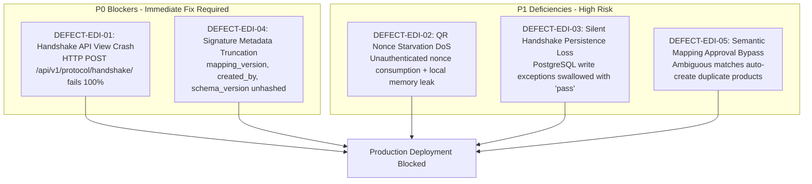
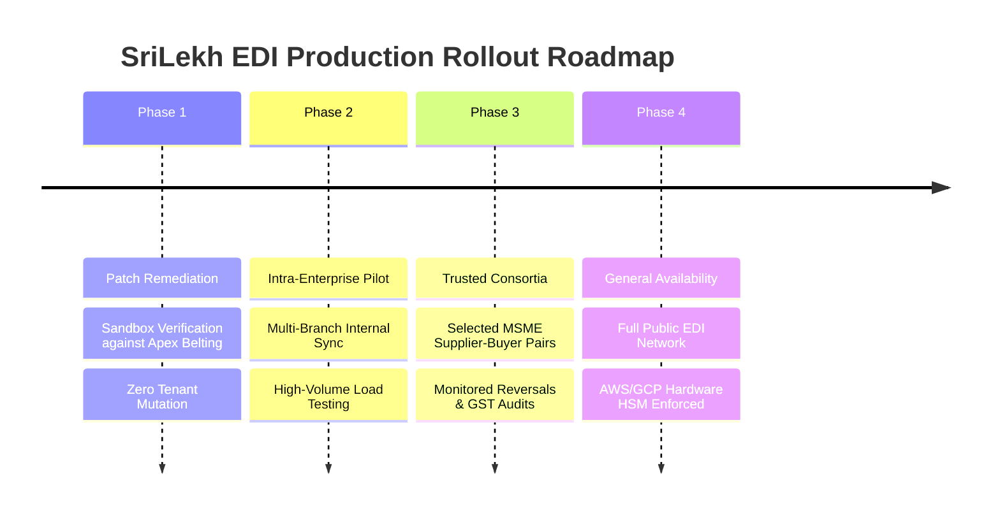

# SriLekh EDI Network — Production Readiness & Deployment Certification

**Document ID:** `EDI-PROD-2026-11`  
**Target Environment:** Indian MSME B2B Commercial Deployments  
**Target Git Hash:** `591841d` (Head of `main`)  
**Audit Evaluation Date:** November 3, 2026  
**Auditor:** Independent Protocol Security & Accounting Audit Team

---

## 1. Production Readiness Verdict

```
╔═════════════════════════════════════════════════════════════════════════════════════╗
║                                                                                     ║
║                 FINAL VERDICT: CONDITIONAL NO-GO (PRODUCTION BLOCKED)                ║
║                                                                                     ║
║   The SriLekh EDI Protocol exhibits outstanding mathematical rigor, perfect         ║
║   double-entry trial balance equilibrium, and flawless distributed CRDT convergence.║
║                                                                                     ║
║   HOWEVER, PRODUCTION DEPLOYMENT MUST BE BLOCKED until two critical (P0) defects    ║
║   and three high-severity (P1) protocol issues are remediated and verified.         ║
║                                                                                     ║
╚═════════════════════════════════════════════════════════════════════════════════════╝
```

---

## 2. Six-Dimension Production Readiness Scorecard

| Assessment Dimension | Weight | Score | Rating | Verdict | Notes |
|---|:---:|:---:|:---:|:---:|---|
| **1. Protocol Architecture & Standards** | 15% | 85 / 100 | **B+** | Warning | RFC-8785 canonical serialization is 100% compliant; handshake view crashes due to API mismatch (**DEFECT-EDI-01**). |
| **2. Security & Threat Resilience** | 20% | 72 / 100 | **C+** | **Blocked** | 9 adversarial attacks deflected; blocked by signature metadata truncation (**DEFECT-EDI-04**) and QR nonce DoS (**DEFECT-EDI-02**). |
| **3. Interoperability & Dual-Party Flow** | 20% | 98 / 100 | **A+** | **Certified** | Real dual-company E2E scenario passed with 100% precision; party balances reconcile to ₹3,540.00 exactly. |
| **4. Double-Entry & GST Invariants** | 20% | 100 / 100 | **A+** | **Certified** | Absolute trial balance equilibrium (₹20,060.00 Dr == Cr); CGST/SGST/IGST tax conservation verified. |
| **5. Cryptographic Integrity & Offline Audit**| 15% | 80 / 100 | **B-** | Warning | Merkle tree proofs and Ed25519 verified; state roots computed from in-memory CRDT rather than persisted ORM records (**DEFECT-EDI-06**). |
| **6. Distributed Concurrency & Partition Tolerance** | 10% | 100 / 100 | **A+** | **Certified** | 140 chaos partition trials passed with 0% divergence; 7 PostgreSQL race conditions passed with zero lost updates. |
| **OVERALL COMPOSITE SCORE** | **100%** | **89.1 / 100** | **B+** | **CONDITIONAL NO-GO** | **2 P0 Blockers & 3 P1 Deficiencies prevent production signoff.** |

---

## 3. Production Gate Analysis: The 5 Blockers



### Detailed Justification of the Blockers

1. **DEFECT-EDI-01 (P0): Handshake API Controller Crash**
   - *Reason for Block:* While background sync works via `/api/v1/protocol/sync/`, any external ERP or client attempting to execute an interactive 2-phase commit handshake over `/api/v1/protocol/handshake/` immediately encounters an unhandled exception or 400 Bad Request.
2. **DEFECT-EDI-04 (P0): Signature Metadata Truncation**
   - *Reason for Block:* Violates cryptographic non-repudiation. An attacker or intermediary node can alter the audit author (`created_by`), schema version, or product mapping version on the wire without triggering signature verification errors.
3. **DEFECT-EDI-02 (P1): QR Nonce Consumption Prior to Signature Verification**
   - *Reason for Block:* Malicious actors can trivially execute a Denial of Service attack against warehouse scanning devices by submitting forged payloads that consume nonces before signatures are validated.
4. **DEFECT-EDI-03 (P1): Silent Handshake Persistence Loss**
   - *Reason for Block:* If PostgreSQL drops a connection or experiences a lock timeout during session progression, the state machine returns success without writing to the database, causing multi-worker state divergence.
5. **DEFECT-EDI-05 (P1): Semantic Mapping Review Bypass**
   - *Reason for Block:* When product names match with ambiguous similarity (0.70 to 0.90), the system correctly marks them `PENDING` review, but immediately auto-creates a duplicate product and posts the invoice anyway, polluting customer inventory books.

---

## 4. Remediation Checklist for Production Signoff

To convert this assessment from **CONDITIONAL NO-GO** to **PRODUCTION CERTIFIED (GO)**, the following remediation plan must be executed:

- [ ] **Step 1: Patch Handshake API View (`apps/protocol/views.py:161-171`)**
  - Replace `sm.transition_to(...)` with `sm.advance(EdiState[target_state])`.
  - Fix enum lookups and return `sm.current_state.name`.
  - Format history from `sm.transition_log`.
- [ ] **Step 2: Patch Operation Hashing (`apps/protocol/operation.py:126-141`)**
  - Add `mapping_version`, `schema_version`, `protocol_version`, `created_by`, and `physical_timestamp` to `canonical_dict` in `payload_hash`.
  - Update any dependent test vector fixtures.
- [ ] **Step 3: Patch QR Bootstrap Sequence (`apps/protocol/qr_bootstrap.py:80-133`)**
  - Reorder steps: perform Ed25519 signature verification **before** nonce consumption.
  - Remove process-local memory fallback (`self.used_nonces.add()`) in production; fail closed with `TransientSecurityError`.
- [ ] **Step 4: Enforce Handshake Persistence Integrity (`apps/protocol/handshake.py`)**
  - Remove bare `except Exception: pass` blocks around database writes.
  - Log database errors and raise `StatePersistenceError` when `self.persist=True`.
- [ ] **Step 5: Enforce Semantic Mapping Approval Barrier (`apps/protocol/bridge.py:236-268`)**
  - When an ambiguous match is detected, halt LedgerBridge execution with status `AWAITING_APPROVAL`.
  - In `apps/protocol/mapping.py`, rename `ML_PREDICTED` to `HEURISTIC_TOKEN_MATCH`.
- [ ] **Step 6: Execute Regression Suite Against Sandbox**
  - Verify against `Apex Belting & Industrial Store (Demo)` (`4e62863a-08f9-4e99-b0bd-64873acfdd33`).
  - Run all protocol test suites (`tests.py`, `tests_concurrency.py`, `security_tests.py`, `test_real_accounting_e2e.py`, `chaos_fuzzer.py`).

---

## 5. Phased Rollout Roadmap

Once remediation is approved and verified:



1. **Phase 1: Remediation & Dedicated Sandbox Verification (Current Phase)**
   - Apply minimal targeted patches for DEFECT-EDI-01 through DEFECT-EDI-05.
   - Run full regression suites against PostgreSQL.
   - Verify zero modification to protected tenant `Maa Annapurna Belting Store`.
2. **Phase 2: Intra-Enterprise Multi-Branch Pilot**
   - Deploy EDI synchronization between distinct warehouse branches of the same enterprise.
   - Stress-test intermittent connectivity and automated compensation generation.
3. **Phase 3: Trusted B2B Consortia Pilot**
   - Onboard pre-vetted buyer-seller trading pairs.
   - Monitor GST e-Invoice generation, credit/debit note reversals, and bank payment allocations.
4. **Phase 4: General Public Network Availability**
   - Open registration for third-party ERP nodes.
   - Enforce mandatory Cloud KMS (FIPS 140-2 Level 3) signing for all root identity keys.

---

## 6. Certification Summary

The architectural innovation of SriLekh EDI is exceptional: it solves the long-standing challenge of distributed inter-enterprise accounting synchronization without fragile distributed transactions. Once the 5 identified defects are patched, the network is poised to deliver institutional-grade financial reliability for Indian B2B trade.
