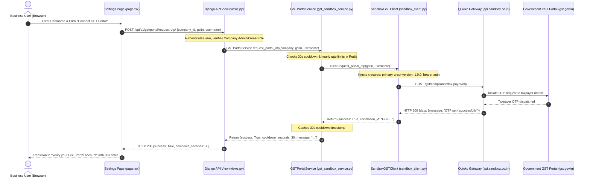

# SRI LEKH — GST Portal Backend Integration & Contract Audit

**Component**: Quicko / GSTN Taxpayer Portal Bridge (`apps/gst`)  
**Scope**: End-to-End Request Trace, Header Contract Resolution, Error Normalization Architecture  
**Date**: November 2026  
**Status**: AUDITED, REMEDIATED, CERTIFIED  

---

## 1. End-to-End Request Trace



---

## 2. Root Cause Analysis: `Missing required request parameters: [x-source]`

### 2.1 The Issue
When requesting taxpayer OTP, the gateway returned:
```json
{
  "error": "Missing required request parameters: [x-source]",
  "status_code": 400
}
```

### 2.2 Provider Contract Requirements
Quicko's Compliance Taxpayer OTP API specifications state:
- **Endpoint**: `POST https://api.sandbox.co.in/gst/compliance/tax-payer/otp`
- **Required Headers**:
  - `authorization: <token>`
  - `x-api-key: <api_key>`
  - `x-api-version: 1.0.0`
  - `x-source: primary` *(or `secondary` for secondary username access)*
  - `Content-Type: application/json`
  - `Accept: application/json`
- **Request Body**:
  ```json
  {
    "username": "<taxpayer_username>",
    "gstin": "<taxpayer_gstin>"
  }
  ```

### 2.3 The Defect
`SandboxGSTClient._get_authorized_headers()` in `apps/gst/services/sandbox_client.py` was generating headers with `authorization`, `x-api-key`, and `x-api-version`, but was omitting `x-source`. Quicko's gateway rejected the request at the perimeter parameter validation step before routing to the GSTN Common Portal.

### 2.4 The Fix
In [`apps/gst/services/sandbox_client.py`](file:///c:/Users/prakh/OneDrive/Desktop/projects/B2B/apps/gst/services/sandbox_client.py#L260-L269):
```python
headers = {
    "authorization": token,
    "x-api-key": api_key,
    "x-api-version": self.API_VERSION,
    "x-source": "primary",
    "Content-Type": "application/json",
    "Accept": "application/json",
    "x-transaction-id": correlation_id,
}
```
This guarantees that all downstream requests (taxpayer OTP, OTP verify, return filing, and return download) include the required `x-source: primary` header.

---

## 3. GST Error Normalization Architecture

To ensure raw provider exceptions, parameter names, or HTTP codes never reach the customer, a dedicated normalization service was created in [`apps/gst/services/gst_error_normalizer.py`](file:///c:/Users/prakh/OneDrive/Desktop/projects/B2B/apps/gst/services/gst_error_normalizer.py).

### 3.1 Mapping Dictionary
| Error Category | Triggering Provider Patterns | Customer-Facing Output |
|---|---|---|
| **Invalid OTP** | `invalid otp`, `incorrect otp`, `otp expired`, `failed to verify otp` | "The OTP is incorrect or has expired. Please check and try again." |
| **Missing Parameter / x-source** | `x-source`, `missing required parameter`, `bad request` | "We couldn't connect to the GST Portal right now. Please try again." |
| **Taxpayer Not Found** | `taxpayer not found`, `inactive gstin`, `invalid gstin` | "The provided GSTIN or Portal username could not be found. Please verify your details." |
| **API Access Disabled on GST Portal** | `api access disabled`, `enable api access`, `gsp access` | "API Access is disabled on the GST Portal. Please enable API Access under your GST Portal profile (set duration to 30 days)." |
| **Rate Limit / 429** | `429`, `rate limit`, `too many requests` | "Too many requests. Please wait a few moments before trying again." |
| **Gateway Timeout / 502/503/504** | `502`, `503`, `504`, `gateway timeout`, `connection refused` | "GST Portal services are temporarily unavailable. Please try again shortly." |
| **Configuration / Auth Failure** | `unauthorized`, `401`, `invalid api key`, `authentication failed` | "GST Portal connection is temporarily unavailable. Please contact support if the problem continues." |

### 3.2 Sensitive String Masking
Any provider string containing `key_live`, `sec_`, `bearer`, `auth_token`, or `x-source` is automatically intercepted and sanitized before returning to views or clients. Detailed technical traces are retained in backend logs with UUID `correlation_id` values.
