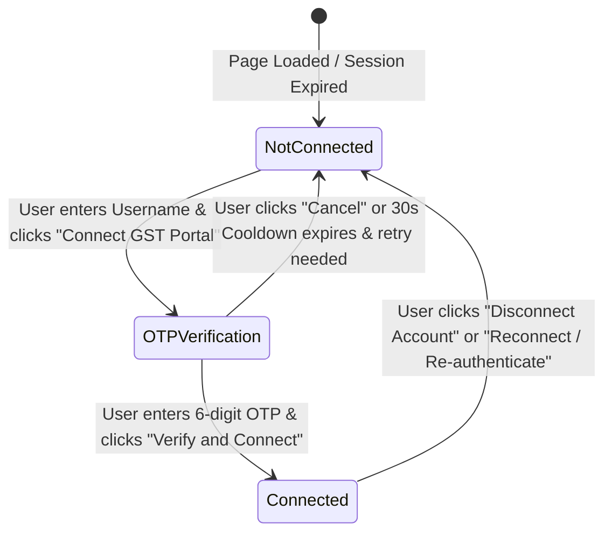

# SRI LEKH — GST Portal Direct Connect UX Redesign Report

**Application**: SriLekh Accounting & ERP (`https://srilekh.com`)  
**Section**: Settings > GST Portal Direct Connect (`/settings?tab=gst-portal`)  
**Design Philosophy**: Professional, Uncluttered, Trustworthy, Business-First  
**Date**: November 2026  
**Status**: DESIGN & IMPLEMENTATION COMPLETE  

---

## 1. Visual Design Architecture: The 3-State Connection Lifecycle

Rather than showing a mixed dashboard with technical readiness indicators and diagnostic buttons, the interface now operates on a clean, single-purpose 3-state state machine:



---

## 2. State-by-State Screen Specification

### 2.1 State 1: Not Connected (Initial State)

```
┌────────────────────────────────────────────────────────────────────────┐
│ 🌐 Government GST Portal                            [ Not Connected ] │
│ Connect your GST Portal account securely to access supported GST       │
│ services directly through SriLekh.                                     │
├────────────────────────────────────────────────────────────────────────┤
│ GST Portal Username                                                    │
│ Enter your registered GST Portal username. We will request a one-time  │
│ OTP directly to your registered mobile number:                         │
│                                                                        │
│ ┌────────────────────────────────────────┐  ┌───────────────────────┐  │
│ │ 09CIFPS1329P2ZL                        │  │ 🔑 Connect GST Portal │  │
│ └────────────────────────────────────────┘  └───────────────────────┘  │
│                                                                        │
│ ℹ Note: By default, your GST Portal username is your 15-character     │
│ GSTIN unless you created a customized API username on the GST Portal.  │
└────────────────────────────────────────────────────────────────────────┘
```
- **Inputs**: Clean text input defaulted to company's GSTIN.
- **Primary CTA**: High-contrast button with loading spinner state ("Connecting...").
- **Eliminated Elements**: No Render credentials box, no Quicko mentions, no `Test Connection` button.

### 2.2 State 2: OTP Verification State

```
┌────────────────────────────────────────────────────────────────────────┐
│ 🌐 Government GST Portal                            [ Not Connected ] │
│ Connect your GST Portal account securely to access supported GST       │
│ services directly through SriLekh.                                     │
├────────────────────────────────────────────────────────────────────────┤
│ 🛡 Verify your GST Portal account                                      │
│ We've requested an OTP for your registered GST Portal account. Enter  │
│ the OTP to continue.                                                   │
│                                                                        │
│ ┌──────────────┐  ┌────────────────────────┐  ┌─────────────────────┐  │
│ │   · · · · ·  │  │ 🛡 Verify and Connect  │  │ Resend OTP in 28s   │  │
│ └──────────────┘  └────────────────────────┘  └─────────────────────┘  │
│                                                                        │
│ [ Cancel ]                                                             │
└────────────────────────────────────────────────────────────────────────┘
```
- **Inputs**: Centered, monospace, 6-digit numeric input with auto-formatting (`replace(/\D/g, '')`).
- **Live Countdown**: Client-side interval synchronized with server's 30-second cooldown (`Resend OTP in 28s`).
- **Resend Action**: Disabled until cooldown completes, then activates as a clean clickable action.
- **Cancel Action**: Returns the user smoothly to State 1 without reloading.

### 2.3 State 3: Connected State

```
┌────────────────────────────────────────────────────────────────────────┐
│ 🌐 Government GST Portal                               [ ● Connected ] │
│ Connect your GST Portal account securely to access supported GST       │
│ services directly through SriLekh.                                     │
├────────────────────────────────────────────────────────────────────────┤
│ ✓ GST Portal Connected                                                 │
│ Your GST Portal account is connected successfully.                     │
│                                                                        │
│ REGISTERED ENTITY                      GSTIN                           │
│ Maa Annapurna Belting Store            09CIFPS1329P2ZL                 │
│                                                                        │
│ SESSION STATUS                                                         │
│ Active session expires: 23/12/2026, 11:24:45 AM                        │
│                                                                        │
│ ┌──────────────────────┐  ┌────────────────────────────────────────┐   │
│ │ 🚪 Disconnect Account│  │ 🔄 Reconnect / Re-authenticate         │   │
│ └──────────────────────┘  └────────────────────────────────────────┘   │
└────────────────────────────────────────────────────────────────────────┘
```
- **Entity Identification**: Clearly displays the company name and formatted monospace GSTIN.
- **Session Expiry**: Human-readable date formatted safely with hydration protection.
- **Session Lifecycle**: Clean "Disconnect Account" button for security/logout, and "Reconnect" button to refresh an expiring token without hassle.

---

## 3. Visual Polish & Design System Alignment

1. **Card Hierarchy**: Styled using standard SriLekh card styling (`bg-card border border-border/50 rounded-2xl p-6 shadow-2xs`).
2. **Color Semantics**:
   - Primary: Brand Navy/Indigo (`bg-primary text-primary-foreground`)
   - Success/Connected: Emerald (`bg-emerald-500/10 text-emerald-600 border-emerald-500/20`)
   - Inactive/Muted: Slate/Zinc (`bg-muted text-muted-foreground`)
   - Error/Alert: Rose (`bg-rose-500/10 text-rose-600 border-rose-500/20`)
3. **Typography**: Clean, professional sans-serif for labels, paired with monospace for GSTINs, OTP inputs, and token timestamps.
