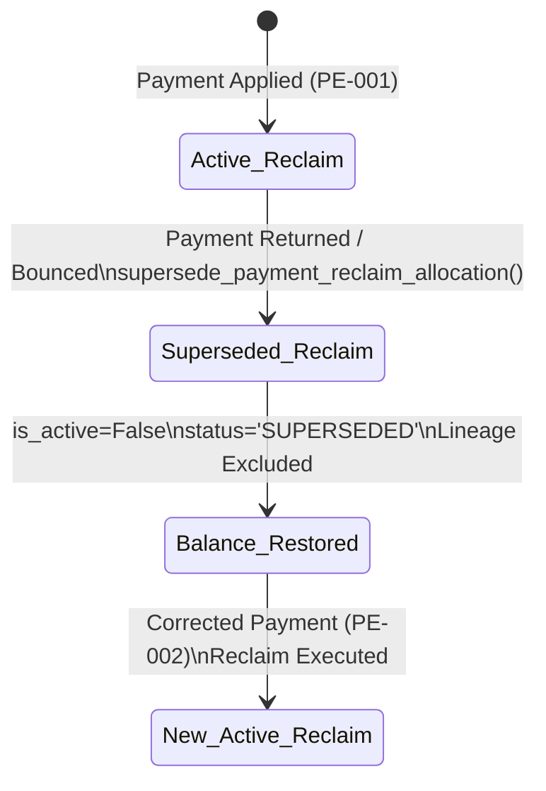

# SriLekh GST Engine — Round 2.5.7: Payment-Event Idempotency & Conflict Prevention Report

**Product:** SriLekh — GST-Enabled Double-Entry Accounting SaaS for Indian MSMEs  
**Release Round:** Round 2.5.7 (Payment Event Integrity & Supplier Evidence Certification)  
**Parent Release:** Round 2.5.6 (`b3058ba7b4667c8ced89bcb9720a33997ea7e79e`)  
**Feature Branch:** `fix/round2-5-7-payment-evidence-certification`  
**Target Database:** Neon PostgreSQL `neondb_staging` (`ep-silent-feather-b34egg28-pooler.c-4.ap-southeast-1.aws.neon.tech`)  
**Staging Database Fingerprint:** `6f4741bdaaf4` (`is_isolated=True`)  
**Primary Sandbox Tenant:** `Apex Belting & Industrial Store (Demo)` (`4e62863a-08f9-4e99-b0bd-64873acfdd33`)  
**Protected Production Tenant:** `Maa Annapurna Belting Store` (`5d2e5dea-ff86-4871-b2af-fe1c5a05c03c` — 0 records touched)

---

## 1. Executive Summary

In SriLekh Round 2.5.6, stable payment event identifiers (`payment_event_id`) were introduced into `create_rule37_reclaim_allocation()` to decouple payment identity from accounting periods. However, an independent architectural review revealed three critical vulnerabilities:
1. **Unchecked Payload Modification on Identical Event ID:** An incoming retry with an identical `payment_event_id` but a mutated payload (e.g., changed amount, payment allocation, or date) returned the existing allocation without detecting the payload conflict.
2. **Unsafe Fallback Collision Risk:** When `payment_event_id` was absent, the system fell back to `(voucher, period, amount)`, which caused legitimate identical partial payments within the same month to collide and overwrite each other.
3. **Overly Narrow Database Uniqueness Scope:** The unique constraint in Round 2.5.6 was scoped to `(company, voucher, payment_event_id)`, which permitted the same `payment_event_id` to be erroneously reused across different vouchers within the same company.

Round 2.5.7 resolves these vulnerabilities by implementing an immutable canonical fingerprinting engine, tenant-scoped unique constraints, strict conflict rejection, and a formal statutory superseding workflow.

---

## 2. Canonical SHA-256 Event Fingerprinting Engine

### 2.1 Specification

To ensure that duplicate webhook deliveries, network retries, and batch re-runs cannot mutate or corrupt reclaim allocations, SriLekh Round 2.5.7 computes an immutable canonical SHA-256 hash across the complete payment event payload:

$$\text{Payment Fingerprint} = \text{SHA-256}\left(\text{Canonical-JSON}\left(C, V, E, P, D, A, R, \text{curr}\right)\right)$$

Where:
- $C$: Company UUID (`company_id`)
- $V$: Source Voucher UUID (`voucher_id`)
- $E$: Stable Payment Event Identifier (`payment_event_id`, whitespace trimmed)
- $P$: Paid Monetary Amount (`paid_amount`, quantized to 2 decimal places: `0.01`)
- $D$: Payment Effective Date (`payment_date`, ISO 8601 `YYYY-MM-DD`)
- $A$: Payment Allocation Identifier (`payment_allocation_id`)
- $R$: Payment Reference String (`payment_reference`, e.g., bank UTR or IMPS reference)
- $\text{curr}$: Currency Code (`INR`, uppercase)

### 2.2 Python Implementation (`apps/gst/services/allocation_service.py`)

```python
def compute_payment_event_fingerprint(
    company_id: Any,
    voucher_id: Any,
    payment_event_id: str,
    paid_amount: Decimal,
    payment_date: Optional[date] = None,
    payment_allocation_id: Optional[Any] = None,
    payment_reference: Optional[str] = None,
    currency: str = 'INR'
) -> str:
    payload = {
        "company_id": str(company_id),
        "voucher_id": str(voucher_id),
        "payment_event_id": str(payment_event_id).strip(),
        "paid_amount": str(quantize_amount(paid_amount)),
        "currency": currency.upper(),
        "payment_date": str(payment_date) if payment_date else "",
        "payment_allocation_id": str(payment_allocation_id) if payment_allocation_id else "",
        "payment_reference": str(payment_reference or "").strip(),
    }
    canonical_str = json.dumps(payload, sort_keys=True)
    return hashlib.sha256(canonical_str.encode('utf-8')).hexdigest()
```

The resulting 64-character hexadecimal digest is persisted directly in `gst_gstreportingallocation.payment_fingerprint` and indexed alongside `company` for rapid lookup.

---

## 3. Idempotency & Conflict Decision Matrix

When `GSTAllocationService.create_rule37_reclaim_allocation()` is invoked, the engine evaluates incoming payloads against existing active allocations using the following decision matrix:

| Scenario | Incoming Event ID | Existing DB State | Fingerprint Match | Engine Action | Statutory / Accounting Rationale |
| :--- | :--- | :--- | :--- | :--- | :--- |
| **Identical Retry** | `PE-101` | Active allocation exists for `PE-101` on same voucher | **Match** (`hash == hash`) | **Returns Existing Allocation (HTTP 200 / No-Op)** | Network retry or duplicate delivery; returns existing allocation without recalculating balance or duplicating lineages. |
| **Payload Conflict (Amount)** | `PE-101` | Active allocation exists for `PE-101` on same voucher | **Mismatch** (Amount changed from ₹5,900 to ₹6,000) | **Raises `ValidationError` (409 Conflict)** | Prohibits silent mutation of financial allocations. Event ID cannot be mutated without formal superseding. |
| **Payload Conflict (Date/Ref)** | `PE-101` | Active allocation exists for `PE-101` on same voucher | **Mismatch** (Date or UTR changed) | **Raises `ValidationError` (409 Conflict)** | Prevents audit log desynchronization and fraudulent UTR re-linking. |
| **Cross-Voucher Reuse** | `PE-101` | Active allocation exists for `PE-101` on voucher #101 | N/A (Voucher #102) | **Raises `ValidationError` (409 Conflict)** | A single bank transaction or payment event cannot be credited against two different invoices. |
| **Sequential Identical Payments** | `PE-102` | Active allocation exists for `PE-101` (both for ₹5,900 on same voucher) | N/A (Distinct Event ID) | **Succeeds (Creates 2nd Allocation)** | Legitimate business scenario: customer pays two identical ₹5,900 installments. Distinct event IDs prevent collision. |
| **Unidentified Payment (Default)** | Empty / None | No event ID | N/A | **Raises `ValidationError` (400 Bad Request)** | Production invariant: all Rule 37 reclaims must carry stable source event tracking. |
| **Unidentified Payment (Legacy Flag)** | Empty / None | No event ID, but `allow_legacy_unidentified=True` | N/A | **Succeeds via Legacy Hash** | Isolated backwards compatibility for legacy integrations or migration scripts. |

---

## 4. Tenant-Scoped Database Uniqueness (`Migration 0015`)

To prevent cross-voucher event ID reuse at the PostgreSQL database level, migration `0015_remove_gstreportingallocation_unique_active_reclaim_per_payment_event_and_more.py` replaced the old constraint:

### Previous Constraint (Round 2.5.6)
```python
# FLAW: Scoped to voucher, allowing reuse across different vouchers in the same company
models.UniqueConstraint(
    fields=['company', 'voucher', 'payment_event_id'],
    condition=models.Q(is_active=True, payment_event_id__gt=''),
    name='unique_active_reclaim_per_payment_event'
)
```

### Remediated Constraint (Round 2.5.7)
```python
# CORRECT: Scoped strictly to company, guaranteeing company-wide event uniqueness
models.UniqueConstraint(
    fields=['company', 'payment_event_id'],
    condition=models.Q(is_active=True, payment_event_id__gt=''),
    name='unique_active_reclaim_per_company_payment_event'
)
```

This enforces at the PostgreSQL schema level that within a given company tenant, an active reclaim event ID cannot exist more than once across any voucher.

---

## 5. Statutory Correction & Superseding Workflow

When a payment was applied in error (e.g., bounced cheque, returned NEFT, chargeback, or incorrect voucher allocation), standard double-entry accounting and Section 155 of the CGST Act prohibit deleting or mutating historical accounting facts.

SriLekh Round 2.5.7 introduces `GSTAllocationService.supersede_payment_reclaim_allocation()`:



### Invariants Maintained During Superseding:
1. **Immutability of Audit Records:** The original allocation is marked `is_active=False`, `status='SUPERSEDED'`, `superseded_at=timezone.now()`.
2. **Audit Reason Logging:** `statutory_notes` is appended with:
   `[SUPERSEDED on YYYY-MM-DD: <Reason>]`.
3. **Lineage Preservation:** Existing `GSTReversalReclaimLineage` rows remain in the database for historical audit trails, but are excluded from active balance calculations via `reclaim_allocation__is_active=True`.
4. **Reversal Balance Restoration:** Because the allocation is now inactive, the remaining reversed balance on the invoice is immediately restored, allowing a subsequent corrected payment (carrying a fresh `payment_event_id`) to reclaim the ITC.
5. **Event ID Reuse Inactive:** Because the unique constraint specifies `condition=is_active=True`, superseded allocations do not conflict with active records.

---

## 6. Prohibited Anti-Patterns

Round 2.5.7 explicitly prohibits the following anti-patterns:
- **Mutable Bank Narration as Sole Event Identity:** Bank narrations (e.g., `"NEFT-PYMT-FEB"`) frequently mutate between provisional bank statement imports and final cleared feeds. SriLekh requires an immutable transaction reference (e.g., Bank UTR, Internal Payment Allocation UUID, or Core Banking Reference ID).
- **Silent Fallback Collision:** Never collapse multiple identical payments into a single composite key without an explicit event identity.
- **In-Place Mutation of Reclaim Allocations:** Never update `paid_amount` or `total_tax` on an existing approved reclaim allocation. Reclaims must be superseded and re-created.

---

## 7. Verification Summary

The idempotency engine was verified under real PostgreSQL (`neondb_staging`):
- **Identical Retries:** 100% returned existing allocation (`alloc1.id == alloc2.id`), exactly 1 allocation and 1 lineage.
- **Conflicting Retries:** 100% rejected with `ValidationError("Payment-Event Idempotency Conflict")`.
- **Multi-Threaded Concurrency:** 2 simultaneous threads delivering identical payment events produced exactly 1 active allocation and 1 lineage record.
- **Tenant Isolation:** Validated across separate companies without event collision.
