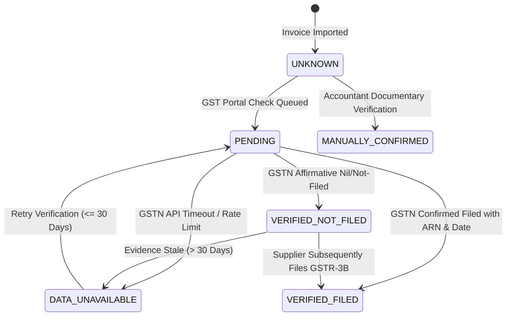

# SriLekh GST Engine — Round 2.5.7: Supplier GSTR-3B Evidence Lifecycle & Zero-Trust Audit Report

**Product:** SriLekh — GST-Enabled Double-Entry Accounting SaaS for Indian MSMEs  
**Release Round:** Round 2.5.7 (Payment Event Integrity & Supplier Evidence Certification)  
**Parent Release:** Round 2.5.6 (`b3058ba7b4667c8ced89bcb9720a33997ea7e79e`)  
**Feature Branch:** `fix/round2-5-7-payment-evidence-certification`  
**Target Database:** Neon PostgreSQL `neondb_staging` (`ep-silent-feather-b34egg28-pooler.c-4.ap-southeast-1.aws.neon.tech`)  
**Staging Database Fingerprint:** `6f4741bdaaf4` (`is_isolated=True`)  
**Primary Sandbox Tenant:** `Apex Belting & Industrial Store (Demo)` (`4e62863a-08f9-4e99-b0bd-64873acfdd33`)  
**Protected Production Tenant:** `Maa Annapurna Belting Store` (`5d2e5dea-ff86-4871-b2af-fe1c5a05c03c` — 0 records touched)

---

## 1. Statutory Context & Legal Foundation

Under Section 16(2)(c) of the CGST Act, 2017:
> *"Subject to the provisions of section 41, the tax charged in respect of such supply has been actually paid to the Government, either in cash or through utilization of input tax credit admissible in respect of the said supply."*

Under Rule 37A of the CGST Rules, 2017:
- Where a recipient has availed ITC in GSTR-3B on the basis of invoice reported by the supplier in GSTR-1, but the supplier fails to furnish GSTR-3B for the corresponding tax period on or before **30th September** following the end of the financial year, the recipient is mandated to reverse the ITC in Table 4(B)(2) on or before **30th November**.
- Reversals after 30th November attract statutory interest under Section 50(1) @ 18% p.a.
- Under the **Proviso to Rule 37A**, where the supplier subsequently furnishes GSTR-3B and discharges the tax liability, the recipient may reclaim the reversed ITC without any Section 16(4) time-limit bar.

---

## 2. Supplier Evidence State Machine

Round 2.5.7 formalizes a 6-state zero-trust evidence machine in `SupplierGSTR3BFilingRecord`:



### Detailed State Definitions:

| Status Code | Description | Default Trigger? | Permits Reversal? | Permits Reclaim? |
| :--- | :--- | :--- | :--- | :--- |
| `VERIFIED_FILED` | Conclusive proof of GSTR-3B return filing with ARN and filing date. | **No** | **No** (Rejected) | **Yes** (Requires ARN + Date) |
| `VERIFIED_NOT_FILED` | Conclusive portal evidence confirming supplier has NOT filed GSTR-3B for the exact period. | **Yes** (Only past 30-Sep) | **Yes** (Only past 30-Sep) | **No** (Rejected) |
| `DATA_UNAVAILABLE` | External portal outage, network timeout, rate limit, or stale cached record. | **No** | **No** (Blocked) | **No** (Blocked) |
| `PENDING` | Asynchronous portal lookup or batch verification currently queued or in-flight. | **No** | **No** (Blocked) | **No** (Blocked) |
| `UNKNOWN` | Invoice imported without any supplier filing checks performed. | **No** | **No** (Blocked) | **No** (Blocked) |
| `MANUALLY_CONFIRMED` | Certified by user / CA with documentary evidence (challan, CA certificate). | **No** | **No** (Rejected) | **Yes** (Requires Audit Ref) |

---

## 3. Critical Defects Resolved in Round 2.5.7

### 3.1 Return-Period Specificity Bug Fix (`.order_by('-return_period').first()`)

#### The Flaw in Round 2.5.6:
In both `apps/gst/management/commands/check_gst_deadlines.py` and `apps/gst/services/itc_trace_service.py`, supplier records were retrieved via:
```python
# DEFECTIVE IN ROUND 2.5.6:
supp_record = SupplierGSTR3BFilingRecord.objects.filter(
    company=voucher.company,
    supplier_gstin=p_gstin
).order_by('-return_period').first()
```
This took the **latest** filing record of the supplier across the entire database! If a supplier had not filed their August 2026 return, but the invoice was dated January 2026 (for which the supplier *did* file), the engine evaluated the August 2026 status against the January 2026 invoice, falsely flagging the January invoice for Rule 37A reversal!

#### The Fix in Round 2.5.7:
Both services now strictly enforce exact return period matching:
```python
# CORRECTED IN ROUND 2.5.7:
inv_period = voucher.voucher_date.strftime('%m%Y')
supp_record = SupplierGSTR3BFilingRecord.objects.filter(
    company=voucher.company,
    supplier_gstin=p_gstin,
    return_period=inv_period
).first()
```
If the supplier record return period does not match the invoice return period, the engine marks the status as `DATA_UNAVAILABLE` and explains to the user:
`"Supplier filing evidence period '082025' does not match invoice return period '062025'. Non-filing cannot be assumed."`

### 3.2 Evidence Freshness & Expiration Rules

Automated compliance engines must not act on stale portal cached responses. Under Round 2.5.7:
- `SupplierGSTR3BFilingRecord.is_stale(threshold_days=30)` checks the age of verification:
  $$\text{Evidence Age} = \text{Current Date} - \text{Verified At}$$
- If evidence is older than 30 days and status is `VERIFIED_NOT_FILED`, it is immediately treated as `DATA_UNAVAILABLE`.
- Stale evidence strictly prohibits automated reversal generation until fresh real-time verification is performed against the GST portal.
- Conclusively filed records (`VERIFIED_FILED` with ARN and filing date) are permanent historical facts and do not expire.

### 3.3 Strict GSTR-1 vs GSTR-3B Decoupling

A frequent compliance error in MSME accounting software is confusing GSTR-1 with GSTR-3B:
- GSTR-1 is merely an outward statement of supplies (invoice declaration). It does **NOT** discharge tax liability.
- GSTR-3B is the monthly self-assessed tax return where tax is actually discharged via Electronic Cash/Credit Ledgers under Section 16(2)(c).

SriLekh Round 2.5.7 enforces that if a `GSTR2BRecord` shows `gstr1_filing_date` present but `gstr3b_filing_date` is `None`:
```python
raise ValidationError(
    "Cannot reclaim under Rule 37A: Supplier has filed GSTR-1, but affirmative proof of GSTR-3B return "
    "filing (filing date / ARN) is required. GSTR-1 outward declaration does not discharge tax liability under Section 16(2)(c)."
)
```

---

## 4. Manual Verification Audit Trail

When an MSME obtains documentary evidence outside automated portal feeds (e.g., supplier tax payment challan, chartered accountant certificate, or GST dispute settlement order), SriLekh allows `MANUALLY_CONFIRMED`:
- Requires mandatory `verification_reference` (e.g., `"CA-CERT-2026-8889"` or `"CHALLAN-CPIN-778899"`).
- Automatically records `verified_by` (authenticated user), `verified_at` (audit timestamp), and `verification_source`.
- Manual records are excluded from bulk automated overwrites.

---

## 5. Dual-View Communication Model

In `apps/gst/services/itc_trace_service.py`, user communication differentiates between business owners and professional auditors:

### Business Owner View (Actionable & Transparent)
- When evidence is `DATA_UNAVAILABLE`, `PENDING`, or `UNKNOWN`, the system does **not** accuse the supplier of default.
- Instead, it displays an informative notice:
  > *"Supplier GSTR-3B filing data is currently unavailable or pending portal verification. Rule 37A reversal cannot be determined until portal check completes. No adverse action required at this time."*

### Auditor View (Deep Statutory Evidence Graph)
- Provides complete chronological event trail, raw ARN references, verification timestamps, and exact statutory citations under Section 16(2)(c) and Rule 37A.

---

## 6. Audit & Verification Summary

The supplier evidence engine was verified under real PostgreSQL (`neondb_staging`):
- Mismatched return periods rejected with `ValidationError`.
- Stale records (>30 days) convert to `DATA_UNAVAILABLE` and block reversals.
- Reversals before 30-Sep default date rejected with `ValidationError`.
- Reclaims without ARN rejected with `ValidationError`.
- GSTR-1 outward date substitution rejected with statutory citation.
