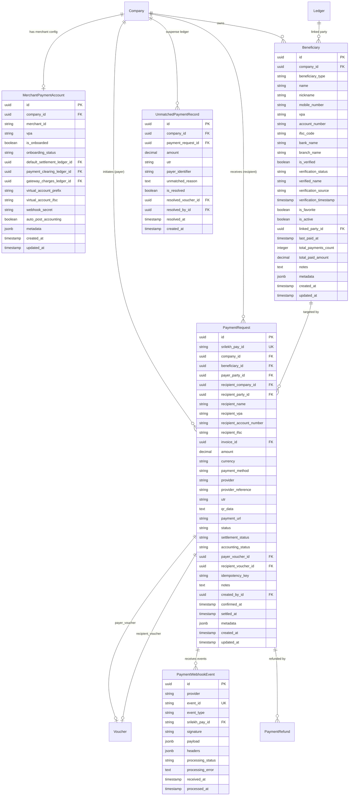

# SriLekh Pay — Database Schema Documentation

## Database Engine
- Engine: PostgreSQL (Neon Cloud)
- Migrations Applied:
  - `apps/payments/migrations/0001_initial.py`
  - `apps/payments/migrations/0002_alter_paymentrefund_status_and_more.py`

---

## 1. Entity-Relationship Diagram (ERD)

---

## 2. Table Specifications & Indexes

### `payments_merchantpaymentaccount`
- `company_id` (Unique ForeignKey to `companies_company`)
- Indexes: `merchant_id`, `created_at`

### `payments_beneficiary`
- Composite Indexes:
  - `[company_id, beneficiary_type, is_active]`
  - `[company_id, mobile_number]`
  - `[company_id, vpa]`
- Foreign Keys:
  - `company_id` -> `companies_company.id` (ON DELETE CASCADE)
  - `linked_party_id` -> `ledgers_ledger.id` (ON DELETE SET NULL)

### `payments_paymentrequest`
- Unique: `srilekh_pay_id`
- Composite / Standard Indexes:
  - `[company_id, status]`
  - `[company_id, idempotency_key]`
  - `provider_reference`
  - `utr`
  - `created_at`
- Foreign Keys:
  - `company_id` -> `companies_company.id`
  - `beneficiary_id` -> `payments_beneficiary.id`
  - `payer_party_id` -> `ledgers_ledger.id`
  - `recipient_company_id` -> `companies_company.id`
  - `invoice_id` -> `accounting_voucher.id`
  - `payer_voucher_id` -> `accounting_voucher.id`
  - `recipient_voucher_id` -> `accounting_voucher.id`

### `payments_paymentwebhookevent`
- Unique: `event_id`
- Indexes: `[provider, event_id]`, `srilekh_pay_id`, `processing_status`, `received_at`

### `payments_unmatchedpaymentrecord`
- Indexes: `[company_id, is_resolved]`, `utr`, `created_at`
- Foreign Keys:
  - `company_id` -> `companies_company.id`
  - `payment_request_id` -> `payments_paymentrequest.id`
  - `resolved_voucher_id` -> `accounting_voucher.id`
