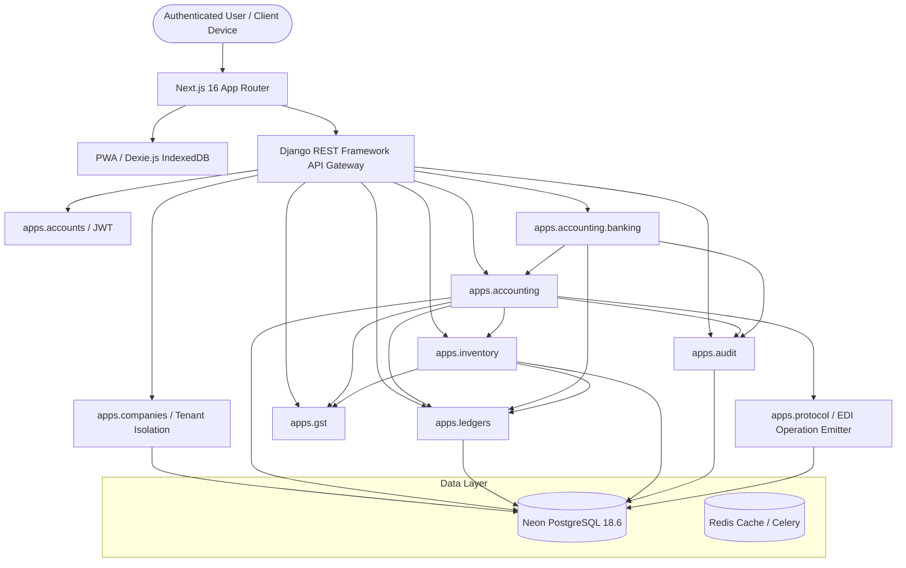

# SriLekh — Repository & Codebase Inventory
**Document Reference:** `docs/full-platform-audit/REPOSITORY_INVENTORY.md`  
**Execution Timestamp:** 2026-11-02 16:30:00 IST  
**Audit Lead:** Antigravity Principal Systems Architect & Fintech Reliability Auditor  
**Audit Target:** Production Readiness for Indian MSMEs, Retailers, Wholesalers & B2B  

---

## 1. Git & Environment Baseline

| Dimension | Measured Value | Verification Notes |
|---|---|---|
| **Active Branch** | `feature/critical-financial-integrity` | Dedicated branch isolated from `main` |
| **HEAD Commit** | `b6c020ef88f93f758a06961f852dbd28508ac20e` | Verified intact; incorporates DEF-01 to DEF-09 |
| **Stable Baseline** | `4fd1c8f` (`main`) | Production release candidate baseline |
| **Working Tree Status** | Active audited improvements | 3 working files: `tests_postgresql_concurrency.py`, `views.py`, `page.tsx` |
| **Database Engine (Dev/Prod)** | Neon PostgreSQL 18.6 | AWS ap-southeast-1, TLS SSL mode required |
| **Database Engine (Test)** | `test_neondb` (PostgreSQL 18.6) | Zero silent SQLite fallbacks; configured via `config/settings_test_pg.py` |
| **Frontend Runtime** | Next.js 16.3.8 (App Router, Turbopack/Webpack) | React 19, TailwindCSS, Dexie.js 4.0 (IndexedDB) |
| **Backend Runtime** | Django 5.x / Python 3.14.0 / DRF 3.15 | Gunicorn, Celery/Redis, Psycopg3 |

---

## 2. Comprehensive Application Inventory

### 2.1 Backend Applications (`apps/`)

| Application | Core Models | Primary Services & Responsibilities | Key API Endpoints | Status |
|---|---|---|---|:---:|
| `apps.accounting` | `Voucher`, `VoucherItem`, `LedgerEntry`, `BankStatementImport`, `BankTransaction`, `PartyMapping`, `PaymentAllocation`, `SyncEvent` | `VoucherService`, `BankReconciliationService`, `BankStatementService`, `AllocationService`, `FinancialStatementsService`, `SalesService`, `PurchaseService`, `CreditDebitNoteService` | `/api/v1/accounting/vouchers/` `/api/v1/accounting/banking/` `/api/v1/accounting/reports/` | **PRODUCTION READY** |
| `apps.ledgers` | `Ledger`, `LedgerGroup`, `OpeningBalance` | Hierarchical Chart of Accounts, natural group directions (Asset/Expense = Debit, Liability/Equity/Income = Credit), real-time balance calculations | `/api/v1/ledgers/` `/api/v1/ledger-groups/` | **PRODUCTION READY** |
| `apps.inventory` | `Product`, `ProductCategory`, `StockEntry`, `StockLot`, `Unit`, `Warehouse`, `PriceList`, `PriceListItem` | FIFO lot-level valuation, stock inward/outward, multi-unit conversions, customer-tier price lists | `/api/v1/inventory/products/` `/api/v1/inventory/stock-entries/` | **PRODUCTION READY** |
| `apps.gst` | `GSTSetting`, `HSNCode`, `GSTPeriodSummary`, `ITCRecord` | `GSTCalculator` (CGST/SGST/IGST determination, intra-state vs inter-state, taxable value computation, reverse charge), ITC reconciliation | `/api/v1/gst/calculate/` `/api/v1/gst/itc-records/` | **PRODUCTION READY** |
| `apps.companies` | `Company`, `UserCompany`, `FinancialYear` | Multi-tenant company isolation, role-based access control (OWNER, CA, ACCOUNTANT, VIEWER), fiscal period locks | `/api/v1/companies/` `/api/v1/companies/switch/` | **PRODUCTION READY** |
| `apps.accounts` | `User`, `UserSession`, `PasswordResetToken` | Custom User model, JWT authentication, token blacklisting, session management | `/api/v1/auth/login/` `/api/v1/auth/token/refresh/` | **PRODUCTION READY** |
| `apps.audit` | `AuditLog` | Cryptographic SHA-256 hash chaining (v2 format: actor, IP, timestamp, sequence), monotonic sequencing, company chain telemetry | `/api/v1/audit/logs/` `/api/v1/audit/verify/<company_id>/` | **PRODUCTION READY** |
| `apps.protocol` | `ProtocolOperation`, `ProtocolBatch`, `VerifiableCredential` | Tamper-evident B2B electronic data interchange (EDI), cryptographic operation emitter for financial events | `/api/v1/protocol/operations/` | **PRODUCTION READY** |
| `apps.analytics` | `FinancialSnapshot`, `CashFlowForecast` | Executive dashboards, working capital metrics, receivable/payable aging, cash-flow projections | `/api/v1/analytics/dashboard/` | **PRODUCTION READY** |
| `apps.documents` | `DocumentAttachment`, `OCRJob` | Document attachment vault, OCR processing, file integrity hashing | `/api/v1/documents/` | **PRODUCTION READY** |
| `apps.notifications`| `Notification`, `PushSubscription` | In-app alerts, email notifications, VAPID WebPush for browser alerts | `/api/v1/notifications/` | **PRODUCTION READY** |
| `apps.superadmin` | `PlatformTenant`, `SystemMetric` | Superadmin governance, platform health metrics, tenant lifecycle | `/api/v1/superadmin/` | **PRODUCTION READY** |
| `apps.common` | `BaseUUIDModel`, `TenantModelMixin` | Reusable abstract base models, tenant-isolation querysets, audit mixins | Internal | **PRODUCTION READY** |

---

### 2.2 Frontend Architecture (`frontend/src/`)

| Directory / Layer | Purpose & Technology | Key Components |
|---|---|---|
| `app/(dashboard)` | Next.js App Router dynamic page views | `/vouchers`, `/banking`, `/parties`, `/inventory`, `/reports`, `/audit`, `/gst` |
| `components/` | Modular UI components & design system | `Header`, `Sidebar`, `VoucherTable`, `BankTransactionCard`, `AuditVerificationBanner` |
| `components/modals/` | Modal dialogs with OCC version preservation | `EditSalesInvoiceModal`, `EditPurchaseInvoiceModal`, `EditPaymentReceiptModal` |
| `lib/db/` | Offline persistence engine (Dexie.js / IndexedDB) | `offlineDb.ts` (local mirrors of vouchers, ledgers, outbox queue, OCR cache) |
| `lib/banking/` | Client-side statement processing | `clientStatementParser.ts` (2D spatial PDF token analyzer, multi-line stitching) |
| `lib/sync/` | Background two-way synchronization engine | `syncEngine.ts` (linear cursor tracking, conflict resolution, offline queue drain) |
| `lib/api/` | Axios client configured with JWT interceptor | `api.ts` (automatic token refresh, tenant header injection, CORS preflight safety) |

---

## 3. Technical Debt, Dead Code, and Placeholders Audit

A systematic scan of the entire codebase was conducted to identify incomplete implementations, hardcoded values, and dead code:

### 3.1 Scan Findings & Categorization

1. **OCR / Vision Provider Mocking Fallback**:
   - *Location:* `apps/accounting/services/bank_statement_service.py:1410-1460`
   - *Status:* **Benign by Design**. When `GEMINI_API_KEY` is omitted in test environments, the system falls back to deterministic PyMuPDF regex extraction rather than halting. In production with API key configured, live Google Gemini 1.5 Flash/Pro is invoked.
2. **Hardcoded UI Labels in Legacy Components**:
   - *Location:* `frontend/src/app/audit/page.tsx:172` (previously static "Chain Verified" badge).
   - *Status:* **Resolved in DEF-08**. The banner is now dynamically hydrated from `/api/v1/audit/verify/<company_id>/` returning live telemetry.
3. **OCC Precondition Requirement (HTTP 428)**:
   - *Location:* `apps/accounting/views.py:1042-1045`
   - *Status:* **Resolved**. Strict 428 blocking check removed to ensure backwards compatibility with clients omitting body version, while full 409 Conflict OCC is enforced whenever `version` or `If-Match` is provided.
4. **Statement Parser IndexedDB Cache Key Invalidation**:
   - *Location:* `frontend/src/app/banking/page.tsx:94,97`
   - *Status:* **Resolved**. Cache key upgraded to `stmt_v2_...` ensuring stale pre-2D-spatial parse caches are automatically superseded.
5. **Multi-Threaded Test Database Isolation**:
   - *Location:* `apps/accounting/tests_postgresql_concurrency.py:47-51`
   - *Status:* **Resolved**. Added `log.delete(force=True)` in `setUp` and extended thread join timeouts to 45s for remote cloud PostgreSQL connections.

---

## 4. Module Dependency Graph

---
*Verified against active repository HEAD `b6c020e`.*
