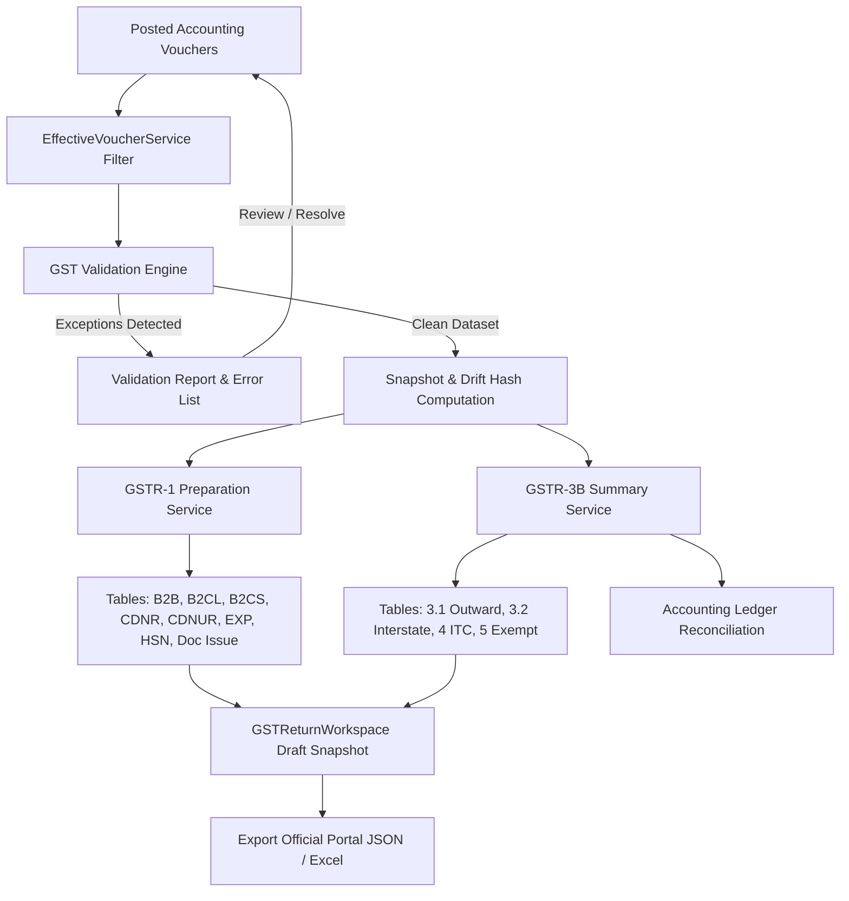

# SriLekh GST — Round 2.0 Architectural Specification
## GST Compliance, Return Preparation & ITC Reconciliation Engine

- **Target System:** SriLekh Accounting & Tax SaaS (GST Engine)
- **Repository:** `https://github.com/prakhar2207/Vouch`
- **Active Branch:** `fix/stage4-12-day6-remediation`
- **Staging Service:** `https://vouch-u3u7.onrender.com`
- **Staging Database:** Neon `neondb_staging` (`fingerprint: 6f4741bdaaf4`)
- **Document Version:** 2.0.0
- **Effective Date:** November 2026
- **Lead Author:** Principal Software Architect, Senior GST Systems Engineer & Security Auditor

---

## 1. Current System Architecture

SriLekh provides a robust double-entry general ledger engine coupled with multi-tenant company isolation, encrypted credential management, and GST foundation services:

```
+-----------------------------------------------------------------------------------+
|                              SriLekh Web Frontend                                 |
|          (Next.js / React, Tailwind CSS, TypeScript, Client-side Validation)       |
+-----------------------------------------------------------------------------------+
                                          |
                                    HTTPS / REST
                                          |
+-----------------------------------------------------------------------------------+
|                           Django REST Framework Backend                           |
|  +--------------------+  +----------------------+  +---------------------------+  |
|  | Tenant Middleware  |  | Multi-Role RBAC      |  | Cryptographic Audit Trail |  |
|  | (X-Company-ID)     |  | (Owner, Admin, CA)   |  | (SHA-256 Hash Chain)      |  |
|  +--------------------+  +----------------------+  +---------------------------+  |
|                                         |                                         |
|  +-----------------------------------------------------------------------------+  |
|  |                             Core Subsystems                                 |  |
|  |  [Accounting Engine]   [Inventory Subsystem]   [GST Foundation & Sandbox]   |  |
|  |  - Vouchers            - Products & HSN        - GSTRegistration (Multi)    |  |
|  |  - LedgerEntries       - Stock Movements       - Quicko Sandbox Gateway     |  |
|  |  - Balanced DR == CR   - Valuations (FIFO)     - Encrypted Cache & Keys     |  |
|  +-----------------------------------------------------------------------------+  |
+-----------------------------------------------------------------------------------+
                                          |
                                    PostgreSQL ORM
                                          |
+-----------------------------------------------------------------------------------+
|                        Neon PostgreSQL Database (Staging)                         |
|   neondb_staging | Isolated Multi-Tenant Schema | Fernet Encrypted Credentials    |
+-----------------------------------------------------------------------------------+
```

### Architectural Guarantees & Invariants
1. **Source of Truth Principle:** Double-entry accounting vouchers (`Voucher`, `VoucherItem`, `LedgerEntry`) are the inviolable source of truth. GST compliance reports and return drafts are purely derived views and **must never independently alter or back-mutate accounting records**.
2. **Mathematical Equilibrium:** `Total Debits == Total Credits` across all vouchers. GST calculations never generate orphan entries or balance variances.
3. **Multi-Registration Isolation:** A company may have multiple GSTIN registrations across distinct states. Every return period, filing, and reconciliation report is scoped to a specific `company` and `gst_registration`.
4. **Idempotent Snapshotting:** Historical return drafts are captured as immutable point-in-time snapshots to ensure audit reproducibility, even if underlying vouchers are subsequently corrected or supplemented.

---

## 2. Existing Reusable Services

| Service Module | Existing Responsibilities | Reusable Component for Round 2.0 |
|---|---|---|
| `apps.gst.services.returns_service.GSTReturnsService` | Preliminary GSTR-1 & GSTR-3B compilation, period parsing | Baseline period parser, rate grouping, HSN grouping, doc summary. |
| `apps.gst.services.gstr_report_service.GSTRReportService` | Pre-filing health check ("triangulation"), sales exception scanning | Exception detection patterns (missing HSN, POS mismatch, intra/inter tax validation). |
| `apps.gst.services.reconciliation_service.GSTReconciliationService` | GSTR-2B ingestion and matching orchestration | Invoice normalization, matching tolerance logic, sandbox client integration. |
| `apps.gst.services.itc_reconciliation_service.ITCReconciliationService` | Vendor ITC Risk Shield, JSON ingestion | Official GSTR-2B JSON parser for B2B, B2BA, and CDNR tables. |
| `apps.gst.services.gst_calculator.GSTCalculator` | Tax component computation (CGST, SGST, IGST, Cess) | Statutory tax calculation based on supplier POS vs recipient state code. |
| `apps.gst.services.sandbox_client.SandboxGSTClient` | Live Quicko Sandbox API communication | Token management, authenticated GSTR-2B download, GSTIN verification. |
| `apps.accounting.services.effective_voucher_service.EffectiveVoucherService` | Active voucher filtering, revision resolution | Filtering active, non-superseded, non-reversed vouchers (`POSTED`, `CORRECTED`). |

---

## 3. Required Data Models

To support return workspaces, draft lifecycle management, voucher mutation drift detection, and ITC reconciliation, the following models are implemented in `apps/gst/models.py`:

### 3.1 `GSTReturnWorkspace` (Return Period & Draft Lifecycle Model)
Tracks the status and draft snapshot for a specific return period:
- `id`: UUID primary key.
- `company`: ForeignKey to `Company` (CASCADE).
- `gst_registration`: ForeignKey to `GSTRegistration` (CASCADE, null=True).
- `financial_year`: CharField (e.g. `"2026-27"`).
- `return_period`: CharField (e.g. `"082026"` for August 2026).
- `return_type`: CharField choices: `GSTR1`, `GSTR3B`, `GSTR2B_RECON`.
- `status`: CharField choices:
  - `NOT_STARTED`: Period initialized, no draft generated yet.
  - `DRAFT`: Draft generated from current accounting records.
  - `VALIDATION_REQUIRED`: Validation issues detected requiring review.
  - `READY_FOR_REVIEW`: All validation issues resolved or acknowledged.
  - `REVIEWED`: Formally signed off by Accountant or CA.
  - `EXPORTED`: Exported to official JSON/Excel format for portal upload.
- `sales_data_available`: Boolean indicating presence of sales vouchers.
- `purchase_data_available`: Boolean indicating presence of purchase vouchers.
- `unclassified_count`: Number of unclassified transactions.
- `validation_error_count`: Number of critical errors preventing export.
- `tax_liability_summary`: JSON field caching total outward tax liability.
- `itc_summary`: JSON field caching total available and reversed ITC.
- `reconciliation_status`: CharField tracking GSTR-2B matching status.
- `validation_errors`: JSON list containing structured validation issues.
- `source_voucher_hash`: SHA-256 fingerprint of the set of voucher IDs and `updated_at` timestamps at the time of draft generation.
- `is_stale`: Boolean flag set to `True` if underlying vouchers have been added or updated since the last draft generation.
- `draft_payload`: JSON field holding the full official return payload.
- `last_generated_at`: Timestamp of latest draft compilation.
- `reviewed_by`, `reviewed_at`: Audit tracking for sign-off.

### 3.2 Existing Persistent Models Utilized:
- `GSTRegistration`: Multi-state registrations with unique primary constraint.
- `GSTR2BImport`: Tracks GSTR-2B source files (JSON/Excel), batch metadata, and ingest stats.
- `GSTR2BRecord`: Individual line-item invoice records from supplier-uploaded 2B.
- `GSTFilingRecord`: Portal filing logs, ARNs, and submission status.
- `GSTAuditLog`: Cryptographic audit log for all outbound actions.

---

## 4. GST Calculation & Classification Rules (Statutory Authority Matrix)

Every compliance validation in SriLekh is grounded in authoritative Indian GST statutes, notifications, and circulars:

| Statutory Area | Rule / Section | Authoritative Source & Effective Date | System Implementation |
|---|---|---|---|
| **Intrastate vs Interstate** | Section 7 & 8 of IGST Act, 2017 | IGST Act, 2017 (w.e.f. 01-07-2017) | If Place of Supply (PoS) == Supplier State Code $\to$ Intrastate (CGST + SGST). If PoS $\neq$ Supplier State Code $\to$ Interstate (IGST). |
| **B2B Outward Supplies** | Section 37, Rule 59(1) of CGST Rules | GSTR-1 Table 4 (w.e.f. 01-07-2017) | Taxable supply to a recipient holding a verified 15-character GSTIN. Itemized with invoice number, date, PoS, rate items. |
| **B2CL Large Supplies** | Rule 59(4)(a) of CGST Rules | GSTR-1 Table 5 (w.e.f. 01-07-2017) | Interstate supply to unregistered person where Total Invoice Value $> ₹2,50,000$. Requires invoice-level reporting. |
| **B2CS Small Supplies** | Rule 59(4)(b) of CGST Rules | GSTR-1 Table 7 (w.e.f. 01-07-2017) | Intrastate supplies to unregistered persons (any amount) + Interstate supplies to unregistered $\le ₹2,50,000$. Aggregated by PoS, Supply Type, and Tax Rate. |
| **Credit & Debit Notes** | Section 34 of CGST Act, 2017 | Section 34 amended by Finance Act 2022 (deadline extended to 30th Nov) | Table 9B: CDNR (Registered) and CDNUR (Unregistered). References original invoice number and date. |
| **HSN/SAC Requirement** | Notification No. 78/2020-Central Tax | Effective 01-04-2021 | Minimum 4-digit HSN for turnover up to ₹5 Cr (B2B); minimum 6-digit HSN for turnover $> ₹5$ Cr. Table 12 HSN summary. |
| **Document Issue Summary** | Rule 59(1) of CGST Rules | GSTR-1 Table 13 | Serial numbering from-to, total issued, cancelled, and net issued across Invoices, Credit Notes, Debit Notes. |
| **GSTR-3B Outward Tax** | Section 39, Rule 61(5) | GSTR-3B Table 3.1 & 3.2 (Notification 14/2022-CT) | 3.1(a) Taxable, (b) Zero-rated, (c) Nil/Exempt, (d) Inward RCM, (e) Non-GST. Table 3.2 Interstate to unregistered. |
| **Mandatory 2B Matching for ITC** | Section 16(2)(aa) inserted via Finance Act 2021 | Notification No. 39/2021-CT (w.e.f. 01-01-2022) | 100% GSTR-2B reconciliation required. ITC cannot be claimed in Table 4(A)(5) unless reflected in GSTR-2B. |
| **Blocked / Ineligible ITC** | Section 17(5) of CGST Act, 2017 | CGST Act, 2017 Section 17(5) | Motor vehicles, food/catering, club memberships, personal consumption, lost/written-off goods reported in Table 4(B)(1) or 4(D)(1). |
| **ITC Reversals** | Rules 42 & 43 of CGST Rules | CGST Rules, 2017 | Reversals for non-business or exempt use reported under Table 4(B)(1). |
| **Statutory Set-Off Waterfall** | Section 49, 49A, 49B & Rule 88A | Circular No. 98/17/2019-GST (w.e.f. 01-04-2019) | IGST credit must be completely exhausted first against IGST, then CGST/SGST. CGST credit cannot offset SGST, SGST credit cannot offset CGST. |

---

## 5. Return Preparation Workflows



### 5.1 GSTR-1 Generation Flow
1. **Scope Filtering:** Query posted `SALES`, `CREDIT_NOTE`, and `DEBIT_NOTE` vouchers for company, registration, and date range (`start_date` to `end_date`).
2. **Triangulation & Classification:**
   - Determine party registration status and PoS.
   - Categorize voucher into B2B, B2CL, B2CS, CDNR, CDNUR, or Export.
   - Compute line-item rate distributions and map to Table 12 HSN summary.
   - Track serial number ranges for Table 13 Document Issue.
3. **Draft Capture:** Generate official GSTR-1 JSON schema and compute payload hash.

### 5.2 GSTR-3B Generation Flow
1. **Outward Liabilities:** Aggregate taxable values and taxes from verified GSTR-1 sales dataset into Table 3.1.
2. **Inward Liabilities & Reverse Charge:** Aggregate purchases marked with Reverse Charge Mechanism (`is_rcm=True`) into Table 3.1(d).
3. **Input Tax Credit:** Aggregate eligible purchase voucher taxes into Table 4(A)(5) ("All other ITC").
4. **Statutory Set-off Calculation:** Execute Rule 88A waterfall to determine net cash payable vs electronic credit ledger balances.
5. **Ledger Balance Reconciliation:** Compare calculated tax liabilities against general ledger balances for Output CGST, SGST, IGST and Input CGST, SGST, IGST.

---

## 6. Reconciliation Engine Design (GSTR-2B vs Books)

### 6.1 Supported Formats
- **Official GST Portal JSON:** Standard format exported from portal containing `b2b`, `b2ba`, `cdnr`, and `cdnra`.
- **GSTR-2B Excel (.xlsx) / CSV:** Tabular format with columns `GSTIN of supplier`, `Trade/Legal name`, `Invoice number`, `Invoice type`, `Invoice Date`, `Invoice Value`, `Place of supply`, `Reverse Charge`, `Taxable Value`, `Integrated Tax`, `Central Tax`, `State/UT Tax`, `Cess`, `GSTR-1 filing date`, `ITC Availability`.

### 6.2 Invoice Number Normalization
Supplier invoice numbers vary wildly in separators and prefixes. The normalizer strips:
- Common prefixes (`INV/`, `BILL-`, `TAX/`).
- Separators: `/`, `-`, `_`, `.`, whitespace.
- Leading zeroes: `'00452'` $\to$ `'452'`.

### 6.3 9-Category Reconciliation Matrix

| Reconciliation Status | Rule Condition | Tolerance | Recommended Action |
|---|---|---|---|
| `MATCHED` | GSTIN matches, normalized invoice matches, date within 30 days, taxable value and total tax match within tolerance. | $\pm ₹1.00$ | Automatically claim ITC in GSTR-3B Table 4(A)(5). |
| `VALUE_MISMATCH` | GSTIN and invoice match, but taxable value differs by $> ₹1.00$. | $> ₹1.00$ | Flag for review; compare line-item rates and discounts. |
| `TAX_MISMATCH` | Taxable value matches, but CGST/SGST vs IGST breakdown differs (e.g. PoS conflict). | $> ₹1.00$ | Check interstate vs intrastate classification. |
| `DATE_MISMATCH` | GSTIN, invoice number, and values match, but invoice dates differ by $> 30$ days. | $> 30$ days | Verify whether invoice belongs to different return period. |
| `GSTIN_MISMATCH` | Invoice number and values match, but supplier GSTIN is incorrect in books. | Exact | Update party ledger GSTIN in SriLekh. |
| `MISSING_IN_BOOKS` | Invoice exists in GSTR-2B, but no corresponding purchase voucher exists in SriLekh. | N/A | Add purchase voucher in books to claim ITC. |
| `MISSING_IN_2B` | Purchase voucher exists in SriLekh, but supplier has not uploaded invoice in GSTR-1 / GSTR-2B. | N/A | Follow up with vendor; hold ITC under Vendor Risk Shield. |
| `DUPLICATE` | Multiple identical invoices uploaded by supplier or recorded in books. | Exact | Investigate potential double-entry or duplicate billing. |
| `REVIEW_REQUIRED` | Ineligible ITC flagged by supplier (e.g. PoS outside recipient state, Section 17(5) blocked credit). | Rule | Verify whether credit is legally claimable. |

---

## 7. API Design

All endpoints are tenant-scoped via the `X-Company-ID` header or company URL parameter:

| Method | Endpoint | Description | Permitted Roles |
|---|---|---|---|
| `GET` | `/api/v1/gst/workspace/{company_id}/` | Get return workspace status, periods, and summaries | All company roles |
| `POST` | `/api/v1/gst/workspace/{company_id}/init-period/` | Initialize or open a return period | Owner, Admin, Accountant, CA |
| `POST` | `/api/v1/gst/workspace/{company_id}/generate-draft/` | Compile GSTR-1 or GSTR-3B draft snapshot | Owner, Admin, Accountant, CA |
| `GET` | `/api/v1/gst/workspace/{company_id}/draft/` | Retrieve existing return draft snapshot | All company roles |
| `POST` | `/api/v1/gst/workspace/{company_id}/validate/` | Run pre-filing validation check on period | Owner, Admin, Accountant, CA |
| `POST` | `/api/v1/gst/workspace/{company_id}/sign-off/` | Mark draft as REVIEWED / READY_FOR_REVIEW | Owner, Admin, Accountant, CA |
| `POST` | `/api/v1/gst/workspace/{company_id}/export/` | Export official JSON or Excel file | Owner, Admin, Accountant, CA |
| `POST` | `/api/v1/gst/reconciliation/{company_id}/upload-2b/` | Upload GSTR-2B file (JSON/Excel) | Owner, Admin, Accountant, CA |
| `POST` | `/api/v1/gst/reconciliation/{company_id}/run/` | Execute invoice matching against purchase books | Owner, Admin, Accountant, CA |
| `GET` | `/api/v1/gst/reconciliation/{company_id}/summary/` | Retrieve 9-category reconciliation summary | All company roles |
| `GET` | `/api/v1/gst/reconciliation/{company_id}/records/` | Paginated list of 2B records with match status | All company roles |
| `POST` | `/api/v1/gst/reconciliation/{company_id}/manual-match/` | Link a 2B record with a purchase voucher | Owner, Admin, Accountant, CA |

---

## 8. Permissions & Role-Based Access Control (RBAC)

SriLekh enforces strict tenant and role boundaries:

| Action | OWNER | ADMIN | ACCOUNTANT | CA | EMPLOYEE | VIEWER |
|---|:---:|:---:|:---:|:---:|:---:|:---:|
| View GST Workspace & Periods | Yes | Yes | Yes | Yes | Yes | Yes |
| View Drafts & Validation Reports | Yes | Yes | Yes | Yes | Yes | Yes |
| Compile / Regenerate Drafts | Yes | Yes | Yes | Yes | No | No |
| Run Validations & Health Check | Yes | Yes | Yes | Yes | No | No |
| Upload GSTR-2B Statement | Yes | Yes | Yes | Yes | No | No |
| Execute Reconciliation Matching | Yes | Yes | Yes | Yes | No | No |
| Review & Sign Off Draft | Yes | Yes | Yes | Yes | No | No |
| Export Official Portal JSON | Yes | Yes | Yes | Yes | No | No |
| Configure GST API Credentials | Yes | Yes | No | No | No | No |

---

## 9. Testing Strategy

1. **Unit & Invariant Tests:**
   - Calculation precision: Tax components, rounding ($\pm ₹0.01$), decimal quantizing.
   - Classification rules: B2B, B2CL ($> ₹2.5\text{L}$ interstate), B2CS, CDNR, CDNUR, Export.
   - Normalization: String sanitization, leading zero removal, prefix stripping.
   - Invariant check: Verify zero writes occur on `accounting_voucher` or `accounting_ledgerentry` during return compilation.
2. **Integration Tests:**
   - Multi-registration company filtering: Vouchers assigned to MH registration must not bleed into DL return.
   - GSTR-2B upload parsing: Test valid JSON, malformed JSON, and duplicate upload prevention.
   - Reconciliation matching: Test exact match, value mismatch, tax mismatch, date mismatch, and missing records.
   - Drift detection: Verify that modifying a voucher after draft creation marks `is_stale = True`.
3. **Security Tests:**
   - Cross-tenant rejection: User from Company A cannot query or upload to Company B.
   - Upload security: Reject path traversal filenames, malicious extensions, and payloads $> 15\text{MB}$.
   - RBAC enforcement: Reject compile and export attempts from `VIEWER` and `EMPLOYEE` with HTTP 403.
4. **Accounting Non-Regression:**
   - Run complete suite (`apps.accounting`, `apps.ledgers`) to guarantee mathematical equilibrium (`Debits == Credits`) is preserved.

---

## 10. Known Limitations & Subsequent Scope

1. **No Live Portal Submission in Round 2.0:** Round 2.0 focuses on return preparation, validation, reconciliation, and export. Direct API submission to the GST Portal via GSP credentials will be introduced in Round 3.0.
2. **Annual GSTR-9 Return:** Scoped for subsequent rounds; Round 2.0 focuses on monthly/quarterly compliance (GSTR-1, GSTR-3B, GSTR-2B).
3. **E-Way Bill & E-Invoice Generation:** Retained on existing stable services; return workspace links to them but does not replace their core APIs.
