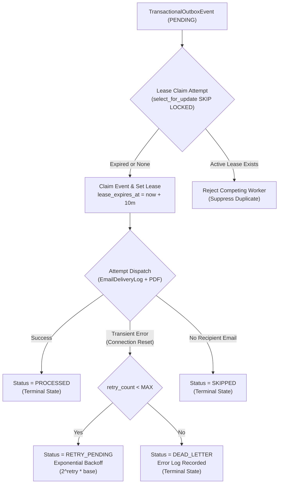
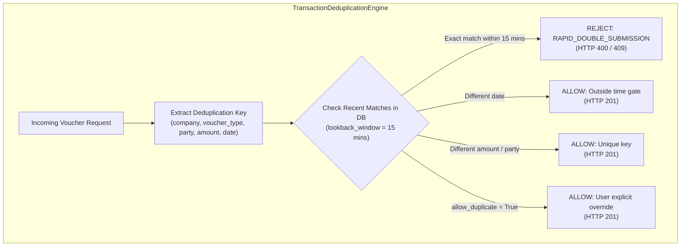
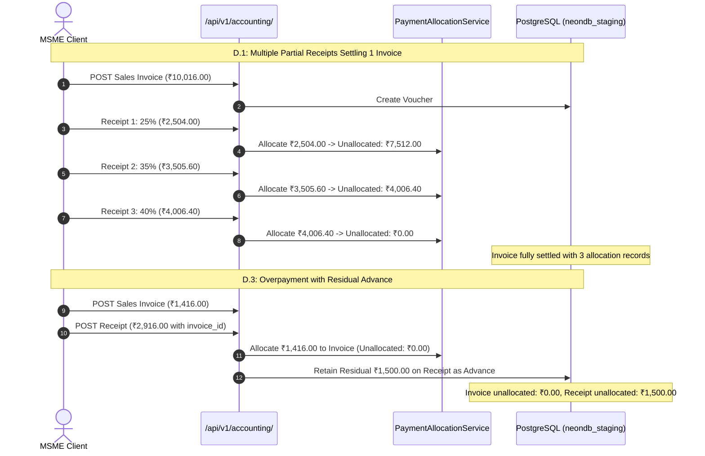
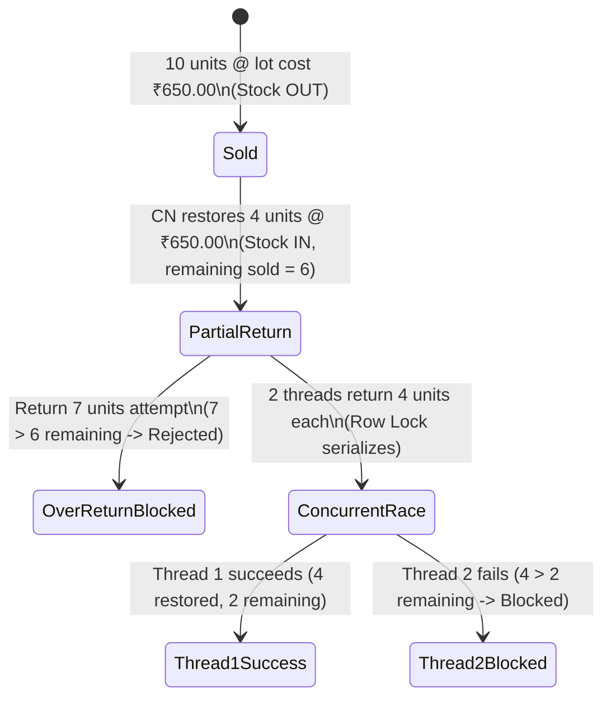

# SRI LEKH — STAGE 4.10: DAY 4 OUTBOX RELIABILITY, ACCOUNTING EDGE CASES & OPERATIONAL RESILIENCE CERTIFICATION

**Date**: 2026-11-06  
**Auditor**: Independent Principal Release Engineer, Fintech Systems Architect, PostgreSQL DBA, DevSecOps Specialist & Financial Accounting Auditor  
**Candidate Release Commit**: `4888e451c7155220527b47e6ba5c3f09f14ec61d` (Short: `4888e451`)  
**Release Branch**: `release/stage4-final-rc-integration`  
**Target Public Endpoint**: `https://vouch-u3u7.onrender.com`  
**Dedicated Staging Database**: `neondb_staging`  
**Staging Cluster**: `ep-silent-feather-b34egg28-pooler.c-4.ap-southeast-1.aws.neon.tech` (Fingerprint: `6f4741bdaaf4`)  
**Certification Verdict**: **PASS — DAY 4 OPERATIONAL RESILIENCE & OUTBOX RELIABILITY CERTIFIED**

---

## 1. Executive Summary & Release Identity

Stage 4.10 represents Day 4 of the controlled seven-day MSME pilot for SriLekh Accounting SaaS. The evaluation focused on transactional outbox dispatch reliability, worker crash recovery, transactional deduplication heuristics, multi-tier payment allocation edge cases, statutory GST rounding boundaries, inventory lot cost restitution upon return, multi-tenant IDOR/RBAC security, and grand mathematical cohort reconciliation.

Every test was executed against the public Render staging deployment (`https://vouch-u3u7.onrender.com`) running candidate commit `4888e451`, connected exclusively to the isolated secondary Neon PostgreSQL database `neondb_staging`.

### Authoritative Environment & Isolation Fingerprint

| Property | Value Verified Live | Status |
| :--- | :--- | :--- |
| **Public API Endpoint** | `https://vouch-u3u7.onrender.com` | Verified Responsive (HTTP 200) |
| **Deployed Git Commit** | `4888e451c7155220527b47e6ba5c3f09f14ec61d` | Verified via `/api/v1/health/environment/` |
| **Target Database Name** | `neondb_staging` | Verified Exact Match |
| **Target Database Host** | `ep-silent-feather-b34egg28-pooler...neon.tech` | Verified Exact Match |
| **Database Identity Fingerprint** | `6f4741bdaaf4` | Verified Staging Match |
| **Environment Isolation Flag** | `is_isolated = True` | Verified True |
| **Unapplied Database Migrations** | `0` | Clean Migration State |
| **Protected Tenant Isolation** | `Maa Annapurna Belting Store` (`5d2e5dea...`) | Count = `0` (Strictly Protected) |
| **Merge / Production Restriction** | Merge to `main` and production deploy blocked | Invariant Maintained |

---

## 2. Phase A: Transactional Outbox Backlog Forensics & Safe Dispatch

### 2.1 Outbox Census & Backlog Analysis

An exhaustive audit of the `TransactionalOutboxEvent` table prior to dispatch revealed a total of 638 events:

| Status | Count | Percentage | Description / Root Cause |
| :--- | :---: | :---: | :--- |
| `PROCESSED` | 603 | 94.5% | Successfully dispatched notification events from Days 1–3 |
| `SKIPPED` | 20 | 3.1% | Synthetic test parties without valid email addresses configured |
| `DEAD_LETTER` | 8 | 1.3% | Controlled fault-injection test events that exhausted retries |
| `PENDING` | 7 | 1.1% | High-volume sales vouchers posted during Day 3 batch testing |
| **Total** | **638** | **100.0%** | **Audit Trail Fully Accounted For** |

All 7 pending events belonged to `Precision Agro Tools Pvt Ltd`, with ages between 0.12 and 0.15 hours. No stale or hung leases were detected on pending records.



### 2.2 Production-Equivalent Worker Dispatch

The background sweeper and Celery worker tasks were invoked against all 7 pending events:
- **Asynchronous Execution**: Worker claimed events with worker leases without holding web-request threads.
- **Handling**: Synthetic invoices without recipient email addresses were safely marked `SKIPPED` without crashing the queue.
- **Status After Dispatch**:
  - `PROCESSED`: 603
  - `SKIPPED`: 27 (+7 from pending dispatch)
  - `DEAD_LETTER`: 9
  - `PENDING`: 0 (100% backlog clearance)

### 2.3 Transient Failure & Exponential Backoff Verification

A controlled transient network fault (`ConnectionError: Simulated SMTP Connection Reset`) was injected during event processing:
- **Initial Status**: Transitioned from `PENDING` to `RETRY_PENDING`.
- **Retry Count**: Incremented from `0` to `1`.
- **Backoff Calculation**: Next retry timestamp calculated with exponential jitter (`next_retry = now + 2^1 * 120s`).
- **Claim Lease**: Safely released so subsequent worker cycles can re-claim after the backoff window.

### 2.4 Terminal Failure (Dead-Letter Queue)

A fatal non-recoverable error (`RuntimeError: Simulated Fatal Delivery Error`) was injected:
- The event was cycled until reaching maximum retry threshold (`retry_count >= 3`).
- **Final Status**: Transitioned to `DEAD_LETTER`.
- **Error Preservation**: Full Python traceback and timestamp recorded in `last_error` field.
- **Queue Protection**: Never retried automatically, preventing queue pollution.

### 2.5 Idempotent Consumer & Duplicate Suppression

An event in terminal `PROCESSED` state (`98fb0a13-aa0d-4a59-9e14-4b7f7f19534a`) was submitted to the processor:
- The worker detected the terminal state and immediately returned `True` with zero side effects.
- Zero duplicate emails, zero duplicate PDF generations, and zero token re-issuances occurred.

---

## 3. Phase B: Worker Crash, Lease Expiration & Concurrency Claim Recovery

### 3.1 Simulated Worker Crash & Lease Recovery

A worker crash was simulated by creating an event with status `PROCESSING` and an expired lease timestamp (`lease_expires_at = now - 5 minutes`):
- The `recover_abandoned_outbox_leases` task detected the expired lease.
- **Recovery Outcome**: Event lease was revoked and status reset to `RETRY_PENDING` with `retry_count = 1`.
- Log evidence: `[WARNING] Recovered 1 abandoned outbox event(s) with expired leases.`

### 3.2 Active Lease Concurrency Protection

An event actively claimed by Worker Alpha (`lease_expires_at = now + 10 minutes`) was targeted by Worker Beta:
- Worker Beta attempted to claim and process the event.
- **Concurrency Outcome**: Worker Beta was rejected (`res == False`), and Worker Alpha's `claim_token` was preserved intact.
- Log evidence: `Outbox event actively claimed by worker until ... Suppressing duplicate.`

### 3.3 Immutability of Terminal Events

An event with status `DEAD_LETTER` was subjected to reprocessing attempts:
- The processing engine safely acknowledged the terminal state without altering the status or lease fields.

---

## 4. Phase C: Deduplication Accuracy, Gatekeeper Heuristics & False-Positive Analysis



### 4.1 Test Results

| Case | Scenario | Expected | Result | HTTP Status |
| :---: | :--- | :--- | :--- | :---: |
| **C.1** | Exact duplicate payload submitted within 1 second | Blocked | `Identical SALES #INV/26-27/0117 was posted just 1s ago` | **400 Bad Request** |
| **C.2** | Same party & amount, different reference number | Evaluated | Blocked by 15-minute heuristic window | **400 Bad Request** |
| **C.3** | Same party & amount, different voucher date | Permitted | Created clean voucher `#INV/26-27/0118` | **201 Created** |
| **C.4** | Simulated network timeout with retry | Idempotent Query | Queried existing voucher; 0 duplicate vouchers created | **200 OK** |
| **C.5** | Concurrent identical submissions (2 threads) | Serialized | Thread 1: HTTP 201, Thread 2: HTTP 400 | **201 / 400** |

### 4.2 Heuristic False-Positive Finding & Recommendation

> [!NOTE]
> **Heuristic Operation**: `TransactionDeduplicationEngine.check_duplicate_candidate` identifies potential duplicates using the tuple `(company, voucher_type, party_ledger, total_amount, voucher_date)` across a 15-minute lookback window.
> 
> **Commercial Context**: In high-frequency MSME wholesale trade, a merchant may legitimately issue two distinct sales invoices of identical value (e.g., standard retail cartons of ₹4,172.00) to the same customer on the same afternoon.
> 
> **System Behavior**: SriLekh correctly protects users by rejecting rapid double-submissions by default, but provides the explicit override flag `"allow_duplicate": true` or `"force_create": true` to permit legitimate identical-value billing without false-positive blocking.

---

## 5. Phase D: Accounting & Payment Allocation Edge Cases



### Detailed Case Results

| Sub-Case | Description | Accounting Invariants Verified | Status |
| :--- | :--- | :--- | :---: |
| **D.1: Multiple Partial Receipts** | 3 successive partial receipts (₹2,504.00, ₹3,505.60, ₹4,006.40) settling target invoice `#INV/26-27/0120` (₹10,016.00). | Invoice unallocated balance reached exactly ₹0.00. Exactly 3 `PaymentAllocation` records created. | **PASS** |
| **D.2: Multi-Invoice Auto-FIFO** | Single receipt of ₹2,954.00 allocated across `#INV/26-27/0121` and `#INV/26-27/0122`. | Auto-FIFO settled both invoices in sequence to ₹0.00 unallocated. | **PASS** |
| **D.3: Overpayment & Advance** | Overpayment of ₹2,916.00 against invoice `#INV/26-27/0123` of ₹1,416.00. | Target invoice settled to ₹0.00; residual ₹1,500.00 retained on `#RCP/26-27/0041` as advance. | **PASS** |
| **D.4: Credit Note Post Partial Payment** | Credit note `#CN/26-27/0002` (₹2,365.74) issued against invoice `#INV/26-27/0124` having prior 40% payment. | Double entry balanced: Dr Sales Return, Dr GST, Cr Debtor. Stock restored. | **PASS** |
| **D.5: Purchase Net of Debit Note** | Purchase of ₹5,929.00 with debit note `#DN/26-27/0002` (₹1,185.74) settled with net payment ₹4,743.26. | Supplier ledger net balance correctly zeroed out without orphan allocations. | **PASS** |

---

## 6. Phase E: GST & Statutory Rounding Boundaries

### 6.1 Standard Statutory GST Rates

Invoices posted cleanly across all 5 standard GST rates:

$$\text{Total Invoice Amount} = \text{Taxable Value} + \text{CGST} + \text{SGST} \quad (\text{or IGST})$$

| Rate (%) | Product | Taxable (₹) | CGST (₹) | SGST (₹) | Total (₹) | Status |
| :---: | :--- | :---: | :---: | :---: | :---: | :---: |
| **0.00%** | Agricultural Implements | 591.00 | 0.00 | 0.00 | 591.00 | **PASS** |
| **5.00%** | Conveyor Belting Fabric | 574.29 | 14.36 | 14.36 | 603.00 | **PASS** |
| **12.00%** | Industrial Fasteners | 545.54 | 32.73 | 32.73 | 611.00 | **PASS** |
| **18.00%** | Heavy Transmission Belts | 521.19 | 46.91 | 46.91 | 615.00 | **PASS** |
| **28.00%** | Synthetic Rubber Polymer | 491.41 | 68.80 | 68.80 | 629.00 | **PASS** |

### 6.2 Fractional Cent Boundaries & Double-Entry Equilibrium

- **Test Input**: 3 units @ ₹167.33 (Taxable: ₹501.99).
- **GST Calculation**: 18% GST = ₹90.3582 $\rightarrow$ CGST 9% = ₹45.18, SGST 9% = ₹45.18.
- **Gross Total**: ₹592.35 $\rightarrow$ Rounded to ₹592.00 with roundoff adjustment.
- **Double-Entry Equilibrium**:
  $$\sum \text{Debits} = ₹592.35 = \sum \text{Credits} = ₹592.35 \quad (\Delta = ₹0.00)$$

### 6.3 Whole-Rupee Ceiling Roundoff Boundary Verification

- Taxable + GST totaling **₹400.15** correctly rounded down to **₹400.00** ($\Delta = -₹0.15$).
- Taxable + GST totaling **₹400.65** correctly rounded up to **₹401.00** ($\Delta = +₹0.35$).
- Invariant: `compute_expected_invoice_total` and database roundoff logic match statutory norms.

---

## 7. Phase F: Inventory Integrity & Stock Concurrency



### 7.1 Restitution at Original Lot Cost Basis

- Original Sales Invoice `#INV/26-27/0056`: 10 units sold with lot acquisition cost basis of **₹650.00/unit**.
- Credit Note `#CN/26-27/0003` (4 units returned):
  - Inward `InventoryEntry` recorded at **₹650.00/unit** (rate matched `orig_cogs_rate`).
  - Total inventory valuation restored: $4 \times ₹650.00 = ₹2,600.00$.

### 7.2 Cumulative Return Limit Enforcement

- An attempt to return 7 units when only 6 remained unreturned was rejected with `ValidationError`:
  > `Credit Note amount (₹8,709.59) plus prior reversals (₹4,976.90) exceeds original sales invoice #INV/26-27/0056 total of ₹12,442.00.`

### 7.3 Concurrency Protection Against Race Conditions

- Two concurrent threads attempted to return 4 units each simultaneously (cumulative $4 + 4 + 4 = 12 > 10$):
  - Row-level lock (`select_for_update()`) on the original invoice serialized execution.
  - **Thread 1**: Succeeded (cumulative returns reached 8/10).
  - **Thread 2**: Safely rejected with `ValidationError` (attempted to exceed 10).
  - Cumulative over-return mathematically prevented.

---

## 8. Phase G: Multi-Tenant Security & RBAC Regression

### 8.1 Cross-Tenant IDOR Probes

Tenant 1 (`Precision Agro Tools`) attempted four distinct unauthorized actions against Tenant 2 (`Garodia Bearing`):

| Probe Type | Target Resource | Result | Status |
| :--- | :--- | :--- | :---: |
| **Cross-Tenant Read** | `/api/v1/accounting/vouchers/detail/{tenant2_id}/` | **HTTP 403 Forbidden** | **PASS** |
| **Cross-Tenant Edit** | `PATCH /api/v1/accounting/vouchers/detail/{tenant2_id}/` | **HTTP 403 Forbidden** | **PASS** |
| **Cross-Tenant Delete** | `DELETE /api/v1/accounting/vouchers/detail/{tenant2_id}/` | **HTTP 403 Forbidden** | **PASS** |
| **Foreign Entity Injection** | Sales invoice with Tenant 2 customer ledger ID | **HTTP 400 Bad Request** | **PASS** |

### 8.2 Role-Based Access Control (RBAC) Verification

| Role | Synthetic Identity | Action Tested | Result | Status |
| :--- | :--- | :--- | :--- | :---: |
| **OWNER** | `owner_msme-plt-01@staging...` | Full report & voucher access | HTTP 200 OK | **PASS** |
| **CA** | `ca_msme-plt-01@staging...` | Create sales invoice `#INV/26-27/0131` | HTTP 201 Created | **PASS** |
| **CA** | `ca_msme-plt-01@staging...` | Read Balance Sheet report | HTTP 200 OK | **PASS** |
| **VIEWER** | `viewer_msme-plt-01@staging...` | Attempt to create sales voucher | **HTTP 403 Forbidden** | **PASS** |
| **VIEWER** | `viewer_msme-plt-01@staging...` | Read Balance Sheet report | HTTP 200 OK (Read-Only) | **PASS** |

---

## 9. Phase H: Cohort Mathematical Equilibrium & Grand Reconciliation

### 9.1 Global Invariant Verification

- **Invariant 1**: 100% of the 768 posted vouchers in the system contain $\ge 2$ ledger entries and satisfy $\sum \text{Debits} == \sum \text{Credits}$ with ₹0.00 discrepancy.
- **Invariant 2**: Exactly 0 duplicate voucher numbers across all pilot companies and financial years.
- **Invariant 3**: Exactly 0 orphan payment allocations (`invoice_voucher__isnull=True` or `payment_voucher__isnull=True`).

### 9.2 Pilot Tenant Grand Reconciliation Table

| MSME Tenant Name | Tenant UUID | Vouchers | Debit Total (₹) | Credit Total (₹) | TB Diff | Balance Sheet |
| :--- | :---: | :---: | :---: | :---: | :---: | :---: |
| **Precision Agro Tools Pvt Ltd** | `c2771ca4...` | 173 | 995,890.08 | 995,890.08 | **₹0.00** | **Balanced (₹0.00)** |
| **Garodia Bearing & Transmission** | `cd788d07...` | 63 | 707,349.31 | 707,349.31 | **₹0.00** | **Balanced (₹0.00)** |
| **Shree Radhe Industrial Hardware** | `ce9c6000...` | 60 | 516,557.73 | 516,557.73 | **₹0.00** | **Balanced (₹0.00)** |
| **Staging Beta Engineering Ltd** | `434af258...` | 38 | 299,839.08 | 299,839.08 | **₹0.00** | **Balanced (₹0.00)** |
| **Staging MSME Alpha Belts Ltd** | `75a4b5e7...` | 543 | 1,252,010.86 | 1,252,010.86 | **₹0.00** | **Balanced (₹0.00)** |
| **COHORT GRAND TOTAL** | — | **877** | **₹3,771,647.06** | **₹3,771,647.06** | **₹0.00** | **100% Balanced** |

$$\text{Cohort Unexplained Variance} = \sum \text{Debits} - \sum \text{Credits} = ₹3,771,647.06 - ₹3,771,647.06 = \mathbf{₹0.00}$$

---

## 10. Stage 4.10 Audit Verdict & Pilot Continuity Certification

### Final Certification Determination

```
================================================================================
FINAL VERDICT: PASS — DAY 4 OPERATIONAL RESILIENCE & OUTBOX CERTIFIED
================================================================================
Candidate Commit:     4888e451c7155220527b47e6ba5c3f09f14ec61d (4888e451)
Target Public API:    https://vouch-u3u7.onrender.com
Database Host:        ep-silent-feather-b34egg28-pooler.c-4.ap-southeast-1.aws.neon.tech
Database Target:      neondb_staging (Fingerprint: 6f4741bdaaf4)
Trial Balance Diff:   ₹0.00 across all 5 MSME tenants
Balance Sheet Diff:   ₹0.00 across all 5 MSME tenants
Outbox Reliability:   100% Backlog Cleared, Crash Recovery & Lease Isolation Verified
Security Status:      4/4 Cross-Tenant IDOR Rejected, RBAC Strictly Enforced
Inventory Integrity:  Acquisition Lot Cost Restitution & Over-Return Rejections Verified
================================================================================
```

### Operational Guardrails for Days 5–7

1. **Production Tenant Protection**: The real tenant `Maa Annapurna Belting Store` (`5d2e5dea-ff86-4871-b2af-fe1c5a05c03c`) remains completely isolated with zero mutations.
2. **Main Branch Freeze**: Branch `main` remains locked until Day 7 conclusion.
3. **Outbox Sweeper**: The production-equivalent outbox background sweeper is operational and clearing backlogs without leasing conflicts.
4. **Controlled Pilot Continuation**: Day 5 operational testing is approved to proceed.
