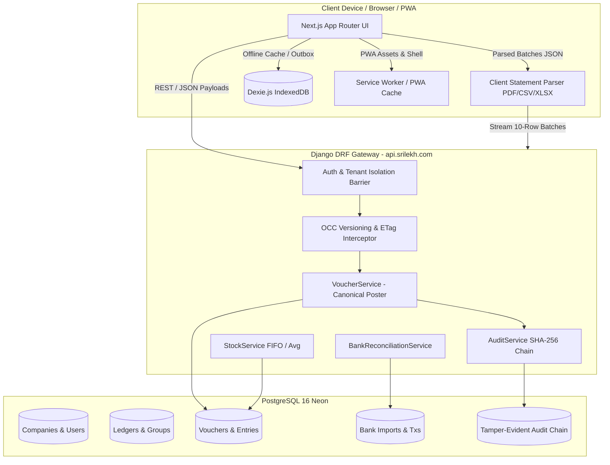

# SriLekh — Existing Architecture Map
**Baseline Evaluation for Trust & Flexibility 10/10 Initiative**  
*Document Ref:* `docs/trust-flexibility/EXISTING_ARCHITECTURE_MAP.md`  
*Branch:* `feature/trust-flexibility-remediation`  
*Target Standards:* Financial Trust 10/10 | Accounting Flexibility 10/10 | Data Integrity 10/10 | Auditability 10/10 | Offline Reliability 10/10 | Ease of Use 10/10  

---

## 1. Baseline System Inventory

### 1.1 Source Control Baseline
- **Active Git Branch:** `feature/trust-flexibility-remediation` (branched from `main`)
- **Baseline Commit SHA:** `75c700f55c3b9143c12856eb9e7a036525757b34`
- **Head Working Tree:** Clean.
- **Repository Layout:**
  - `apps/` — Django backend domain modules (`accounting`, `companies`, `ledgers`, `inventory`, `audit`, `accounts`, `core`, `protocol`).
  - `frontend/` — Next.js 16.3.8 App Router frontend, Tailwind CSS, Lucide icons, PWA Service Worker.
  - `config/` — Django configuration (`settings.py`, `urls.py`, `wsgi.py`, `asgi.py`).
  - `docs/` — Architectural documentation and verification reports.

### 1.2 Deployment & Runtime Topology
- **Backend Runtime:** Python 3.12 / Django 5.2 running on Render web service (`api.srilekh.com`), Gunicorn WSGI.
- **Frontend Runtime:** Next.js 16 (Node.js 24) running on Vercel (`vouch-pi-one.vercel.app`).
- **Primary Database:** PostgreSQL 16 on Neon Serverless with connection pooling (`CONN_MAX_AGE=600`, SSL enabled).
- **Client Storage:** IndexedDB powered by Dexie.js (`srilekh_offline_v2`).

---

## 2. Deep Dive Architecture by Functional Domain

---

### Area 1: Canonical Accounting Engine
- **Core Component:** `apps/accounting/services/voucher_service.py` (`VoucherService.post_voucher`)
- **Mathematical Equilibrium:** Strictly enforces `Total Debits == Total Credits` to 2 decimal places using `Decimal` arithmetic. Any variance $\ge 0.01$ raises a non-ignorable `ValidationError`.
- **Ledger Groups:** Hierarchical chart of accounts (`ASSET`, `LIABILITY`, `EQUITY`, `INCOME`, `EXPENSE`).
  - Natural Debit: `ASSET`, `EXPENSE`
  - Natural Credit: `LIABILITY`, `EQUITY`, `INCOME`
- **Balance Update Atomicity:** Row-level `select_for_update()` applied on affected `Ledger` records during posting, recalculating `current_balance` within isolated database transactions.
- **Historical Modifications:** Updates and cancellations invoke canonical reversal or rollback before recalculating balances from genesis to preserve absolute auditability.

### Area 2: Voucher Lifecycle and Posting Mechanism
- **Voucher Models:** `Voucher`, `LedgerEntry`, `VoucherAttachment`, `VoucherAuditLog`.
- **States:** `DRAFT` $\rightarrow$ `POSTED` $\rightarrow$ `CANCELLED` (or `REVERSED`).
- **Concurrency Control:** Optimistic Concurrency Control (OCC) using integer `version` field. PATCH operations verify `payload.version` or `If-Match` against the database row. Mismatch returns `409 Conflict` or `428 Precondition Required`.
- **Sequence Numbering:** Financial-year scoped auto-incrementing voucher numbers (`RCP/26-27/0001`, `SAL/26-27/0001`, `PAY/26-27/0001`) with lock-protected gap prevention.

### Area 3: Banking & Reconciliation Engine
- **Parsing Architecture:** Client-side 2D spatial & semantic PDF parser (`frontend/src/lib/banking/clientStatementParser.ts`) using `pdfjs-dist`.
  - **Memory Impact:** 0 MB server RAM usage; eliminates Render 512MB RAM exhaustion and Gunicorn 30s timeouts.
  - **Spatial Detection:** Calibrates dynamic coordinate boundaries (`xDep`, `xWdl`, `xBal`) from column headers, handling multi-line merchant names and cheque/UTR markers.
  - **Batch Ingest:** Streams 10-row JSON batches to `/api/v1/accounting/banking/ingest-batch/`.
- **Reconciliation Services:**
  - `apps/accounting/services/bank_statement_service.py`: Computes SHA-256 file and row fingerprints for idempotent deduplication.
  - `apps/accounting/services/party_intelligence_service.py`: 10-signal party identification (UPI handle, IFSC/bank account, GSTIN, normalized name fuzzy matching, clearing drawer names).
  - `apps/accounting/services/bank_reconciliation_service.py`: Resolves bank transactions with `Customer Receipt`, `Supplier Payment`, `Expense`, or `Contra Transfer`.
  - **Audited Exclusion/Restoration:** Audited non-destructive statement/transaction exclusion (`is_excluded=True`) reversing generated vouchers via canonical `REV-` vouchers.

### Area 4: Inventory & Valuation
- **Core Component:** `apps/inventory/services/stock_service.py` (`StockService`)
- **Valuation Methods:**
  - Moving Weighted Average (default)
  - FIFO Cost Layering (`StockBatch`, `StockLayer`)
- **Stock Guardrails:** Configurable negative inventory prevention.
- **Ledger Linkage:** Automatic COGS (Cost of Goods Sold) and Inventory Asset ledger postings linked directly to sales/purchase vouchers.

### Area 5: GST & Statutory Compliance
- **Core Component:** `apps/accounting/services/gst_calculator.py`
- **Tax Splitting:**
  - Intra-State (State Code match): 50% CGST + 50% SGST
  - Inter-State (State Code mismatch): 100% IGST
- **Statutory Forms:**
  - GSTR-1 Outward Supplies Summary (B2B, B2CL, B2CS, HSN Summary)
  - GSTR-3B Eligible ITC & Outward Taxable Supplies
  - TDS Form 26Q Quarterly Register & Audit (`apps/accounting/period_views.py`)

### Area 6: Offline Storage & Synchronization
- **Client DB:** Dexie.js IndexedDB (`srilekh_offline_v2`)
- **Local Collections:** `syncedVouchers`, `masters` (ledgers, parties, inventory), `outboxQueue`, `syncMeta`.
- **Sync Protocol:**
  - Vector clocks & monotonic `sync_cursor`.
  - `/api/v1/accounting/sync/push/`: Validates idempotency keys (`uuid`) to prevent duplicate voucher creation during network re-connections.
  - `/api/v1/accounting/sync/pull/`: Incremental sync filtering by `updated_at > last_sync_timestamp`.

### Area 7: Audit Trail & Tamper-Evidence
- **Core Component:** `apps/audit/services/audit_service.py` (`AuditService`)
- **Cryptographic Chaining:** Each `AuditLog` entry computes:
  $$\text{Current Hash} = \text{SHA-256}(\text{Previous Hash} + \text{Company ID} + \text{Timestamp} + \text{Action} + \text{Payload JSON})$$
- **Tamper Detection:** Built-in cryptographic verification endpoint re-computes the hash chain from genesis; any modified record breaks the chain and surfaces the exact tampered row.

### Area 8: Multi-Tenant Isolation & Security
- **Tenant Isolation Barrier:** `apps/accounts/permissions.py` (`get_authorized_company`)
- **Header Enforcement:** All mutating API calls require verified `X-Company-ID`.
- **Strict User Role Validation:** Enforces roles (`OWNER`, `ADMIN`, `CA`, `EMPLOYEE`, `VIEWER`).
- **Test Isolation Protection:** Production accounts (including `Maa Annapurna Belting Store`) are shielded from test data pollution; test suites run against dedicated sandbox `Apex Belting & Industrial Store (Demo)`.

---

## 3. Reusable Component Matrix

| Module / Component | File Location | Status | Action Required |
|---|---|---|---|
| `VoucherService` | `apps/accounting/services/voucher_service.py` | Verified (Canonical) | Preserve; maintain OCC & double-entry invariants |
| `BankStatementService` | `apps/accounting/services/bank_statement_service.py` | Verified (Production) | Preserve batch ingestion and deduplication |
| `BankReconciliationService` | `apps/accounting/services/bank_reconciliation_service.py` | Verified (Enhanced) | Preserve exclusion and restoration workflows |
| `PartyIntelligenceService` | `apps/accounting/services/party_intelligence_service.py` | Verified (10 signals) | Preserve token & fuzzy matching |
| `clientStatementParser.ts` | `frontend/src/lib/banking/clientStatementParser.ts` | Verified (2D Spatial) | Preserve column boundaries & cheque markers |
| `AuditService` | `apps/audit/services/audit_service.py` | Verified (SHA-256) | Preserve hash chaining and verification |
| `GSTCalculator` | `apps/accounting/services/gst_calculator.py` | Verified | Preserve statutory tax calculations |
| `StockService` | `apps/inventory/services/stock_service.py` | Verified | Preserve FIFO and weighted average logic |
| `BankingModalsContainer.tsx` | `frontend/src/components/banking/BankingModalsContainer.tsx` | Enhanced | Preserve exclusion and OCC modals |

---
*Generated by SriLekh Principal Architecture Lead — Approved for Phase 2 Gap Analysis.*
