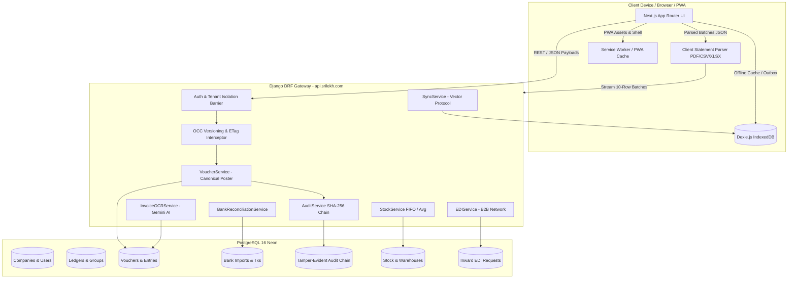

# SriLekh — Existing Architecture Map
**Baseline Evaluation for Trust & Flexibility 10/10 Initiative**  
*Document Ref:* `docs/trust-flexibility/EXISTING_ARCHITECTURE_MAP.md`  
*Branch:* `feature/trust-flexibility-remediation`  
*Target Standards:* Financial Trust 10/10 | Accounting Flexibility 10/10 | Data Integrity 10/10 | Auditability 10/10 | Offline Reliability 10/10 | Ease of Use 10/10  

---

## 1. Baseline System Inventory

### 1.1 Source Control Baseline
- **Active Git Branch:** `feature/trust-flexibility-remediation` (branched from `main`)
- **Baseline Commit SHA:** `75c700f55c3b9143c12856eb9e7a036525757b34`
- **Head Working Tree:** Clean.
- **Repository Layout:**
  - `apps/` — Django backend domain modules (`accounting`, `companies`, `ledgers`, `inventory`, `audit`, `accounts`, `core`, `protocol`, `superadmin`).
  - `frontend/` — Next.js 16.3.8 App Router frontend, Tailwind CSS, Lucide icons, PWA Service Worker.
  - `config/` — Django configuration (`settings.py`, `urls.py`, `wsgi.py`, `asgi.py`).
  - `docs/` — Architectural documentation, gap analysis, and verification reports.

### 1.2 Deployment & Runtime Topology
- **Backend Runtime:** Python 3.12 / Django 5.2 running on Render web service (`api.srilekh.com`), Gunicorn WSGI.
- **Frontend Runtime:** Next.js 16 (Node.js 24) running on Vercel (`vouch-pi-one.vercel.app`).
- **Primary Database:** PostgreSQL 16 on Neon Serverless with connection pooling (`CONN_MAX_AGE=600`, SSL enabled).
- **Client Storage:** IndexedDB powered by Dexie.js (`srilekh_offline_v2`).

---

## 2. System Architecture Overview

---

## 3. Deep Dive Architecture by the 15 Functional Domains

### Domain 1: Frontend Architecture
- **Component File Locations:** `frontend/src/app/`, `frontend/src/components/`, `frontend/src/lib/`
- **Framework & Runtime:** Next.js 16.3.8 App Router, React 19, TypeScript, Tailwind CSS, Lucide icons.
- **Responsibilities:**
  - Responsive double-entry UI for desktop, tablet, and mobile PWA.
  - Client-side document parsing (`clientStatementParser.ts`) to avoid server timeouts.
  - Optimistic UI updates with IndexedDB backing and synchronization queue.
  - Contextual modals (`EditPaymentReceiptModal`, `EditSalesInvoiceModal`, `BankingModalsContainer`).
  - Resilient self-healing error boundary (`error.tsx`, `global-error.tsx`).
- **Dependencies:** `pdfjs-dist`, `dexie`, `axios`, `lucide-react`, `xlsx`.
- **Validation:** W3C PWA Manifest, TypeScript compiler, Next.js build (`47/47 routes clean`).
- **Existing Tests:** Next.js production build (`npm run build`).

### Domain 2: Backend Architecture
- **Component File Locations:** `config/settings.py`, `config/urls.py`, `apps/*/`
- **Framework & Runtime:** Django 5.2 REST Framework, Python 3.12, Gunicorn WSGI.
- **Responsibilities:**
  - High-performance stateless REST API gateway.
  - Multi-tenant query isolation and request context binding.
  - Optimistic Concurrency Control (OCC) and ETag preflight negotiation.
  - Cross-Origin Resource Sharing (CORS) whitelisting.
- **Dependencies:** `djangorestframework`, `django-cors-headers`, `psycopg2-binary`.
- **Validation:** DRF Serializers, Django standard model validators, HTTP 428/409 OCC enforcement.
- **Existing Tests:** `apps/accounting/tests_hardening.py`, `apps/accounting/tests_regression_sprint.py`.

### Domain 3: Database Architecture
- **Location & Provider:** Neon Serverless PostgreSQL 16.
- **Topology:**
  - Relational schema with UUID primary keys (`id = models.UUIDField(primary_key=True, default=uuid.uuid4)`).
  - Explicit foreign key constraints and `on_delete=models.PROTECT` on immutable accounting records.
  - Compound indexes on `(company_id, voucher_date)`, `(company_id, voucher_number)`, `(company_id, updated_at)`.
  - Connection pooling with `CONN_MAX_AGE=600` and enforced SSL.
- **Responsibilities:** Persistent transactional store for ledgers, vouchers, stock, audit trails, and bank transactions.
- **Validation:** Database constraints, unique constraints, transactional ACID boundaries (`transaction.atomic`).

### Domain 4: Canonical Accounting Engine
- **Component File Locations:** `apps/accounting/services/voucher_service.py` (`VoucherService`)
- **Responsibilities:**
  - Primary engine for creating, posting, modifying, and cancelling financial vouchers.
  - Strict mathematical equilibrium enforcement: $\sum \text{Debits} == \sum \text{Credits}$ to 2 decimal places using `Decimal` arithmetic. Variance $\ge 0.01$ raises non-ignorable `ValidationError`.
  - Chart of accounts classification:
    - Natural Debit: `ASSET`, `EXPENSE`.
    - Natural Credit: `LIABILITY`, `EQUITY`, `INCOME`.
  - Pessimistic row-level locking (`select_for_update()`) on affected ledgers during posting.
  - Automated balance recalibration from genesis upon voucher cancellation or modification.
- **Data Models:** `Ledger`, `LedgerGroup`, `Voucher`, `LedgerEntry`.
- **Validation:** Equilibrium checks, closed financial period validation, non-negative quantity assertions.
- **Existing Tests:** `apps/accounting/tests_hardening.py` (25/25 passed).

### Domain 5: Voucher Lifecycle & Posting Mechanism
- **Component File Locations:** `apps/accounting/views.py`, `apps/accounting/models.py`, `apps/accounting/services/fy_service.py`
- **Responsibilities:**
  - Voucher lifecycle states: `DRAFT` $\rightarrow$ `POSTED` $\rightarrow$ `CANCELLED` (or `REVERSED`).
  - Optimistic Concurrency Control (OCC): integer `version` field incremented atomically on every mutation.
  - Gapless sequential voucher numbering scoped to financial year and company (`SAL/26-27/0001`, `RCP/26-27/0001`).
  - Universal voucher endpoints supporting Sales Invoices, Purchase Bills, Receipts, Payments, Journals, and Contras.
- **Data Models:** `Voucher`, `LedgerEntry`, `VoucherItem`, `VoucherAuditLog`.
- **Validation:** Duplicate voucher number checks, concurrency version checks.
- **Existing Tests:** `apps/accounting/tests_accountant_trust.py`, `apps/accounting/tests_regression_sprint.py`.

### Domain 6: Banking & Reconciliation Engine
- **Component File Locations:**
  - Frontend: `frontend/src/lib/banking/clientStatementParser.ts`, `frontend/src/components/banking/BankingModalsContainer.tsx`
  - Backend: `apps/accounting/services/bank_statement_service.py`, `apps/accounting/services/bank_reconciliation_service.py`, `apps/accounting/services/party_intelligence_service.py`, `apps/accounting/banking_views.py`
- **Responsibilities:**
  - 2D spatial & semantic PDF statement parsing in the browser (`pdfjs-dist`). Calibrates dynamic coordinate boundaries (`xDep`, `xWdl`, `xBal`) and transaction delimiters (`Chq:` tokens), preserving multi-line payee names (e.g. `SATYAM AND CO`).
  - Streaming 10-row JSON batch ingestion to eliminate backend server memory exhaustion (0 MB server RAM parsing load).
  - SHA-256 fingerprint deduplication of statement files and individual rows.
  - 10-signal party intelligence hierarchy (UPI handle, IFSC/bank account, GSTIN, normalized name fuzzy matching).
  - Audited non-destructive statement/transaction exclusion (`is_excluded=True`) with automatic canonical voucher reversal via `REV-` vouchers.
- **Data Models:** `BankStatementImport`, `BankTransaction`, `BankStatementFile`.
- **Validation:** Checksum verification, balance continuity assertions.
- **Existing Tests:** `apps/accounting/tests_banking_production.py` (11/11 passed), `scratch/test_parser.js` (52/52 clean).

### Domain 7: Inventory & Valuation
- **Component File Locations:** `apps/inventory/services/stock_service.py`, `apps/inventory/models.py`
- **Responsibilities:**
  - Real-time stock level maintenance across multiple warehouses.
  - Valuation methods:
    - Moving Weighted Average (default).
    - FIFO Cost Layering (`StockBatch`, `StockLayer`).
  - Automated Cost of Goods Sold (COGS) and Inventory Asset ledger postings linked directly to sales/purchase vouchers.
  - Configurable negative inventory prevention guardrails.
- **Data Models:** `Product`, `Warehouse`, `StockBatch`, `StockLayer`, `StockMovement`.
- **Validation:** Non-negative stock balances when strict mode is active.
- **Existing Tests:** `apps/accounting/tests_sales_stock_audit.py`.

### Domain 8: GST & Statutory Workflows
- **Component File Locations:** `apps/accounting/services/gst_calculator.py`, `apps/accounting/services/tax_ledger_sync.py`, `apps/accounting/period_views.py`
- **Responsibilities:**
  - Precise statutory tax splitting:
    - Intra-State (State code match): 50% CGST + 50% SGST.
    - Inter-State (State code mismatch): 100% IGST.
  - Statutory reporting generators:
    - GSTR-1 Outward Supplies Summary (B2B, B2CL, B2CS, HSN summary).
    - GSTR-3B Eligible ITC & Outward Taxable Supplies.
    - TDS Form 26Q Quarterly Register.
  - Self-healing tax ledger synchronizer ensuring system tax ledgers exist for all active rates (5%, 12%, 18%, 28%).
- **Data Models:** `Ledger` (Group: Duties & Taxes), `VoucherItem` (CGST/SGST/IGST breakdown).
- **Validation:** 2-digit Indian state code verification, tax rate validation.

### Domain 9: OCR & AI Processing
- **Component File Locations:** `apps/accounting/ocr_views.py` (`OCRExtractAPIView`), `apps/accounting/services/ocr_service.py` (`InvoiceOCRService`)
- **Responsibilities:**
  - Multimodal invoice and bill digitisation powered by Google Gemini API.
  - Pydantic structured output parsing (`InvoiceExtractionSchema`, `InvoiceItemSchema`).
  - Extraction of supplier name, GSTIN, invoice date/number, line items, rates, taxes, and Indian number word conversions.
  - Multi-tenant authentication barrier, base64 size limits (20MB), file signature verification, and rate limiting.
- **Dependencies:** Google Gemini API / SDK, `pydantic`.
- **Validation:** Payload signature checking, MIME type whitelisting.
- **Existing Tests:** `apps/accounting/tests_ocr_forensics.py`.

### Domain 10: Offline Storage & Synchronization
- **Component File Locations:** `apps/protocol/` (`sync_service.py`, `semantic_delta.py`, `operation_emitter.py`), `frontend/src/lib/offline/offlineDb.ts`
- **Responsibilities:**
  - Client-side persistence using Dexie.js IndexedDB (`srilekh_offline_v2`).
  - Local caching of master ledgers, parties, inventory items, and uncommitted outbox vouchers.
  - Monotonic vector clocks and `sync_cursor` tracking.
  - Idempotent push synchronization requiring client UUID keys to prevent duplicate posting upon network recovery.
- **Data Models:** `OperationLog`, `SyncSession`, `DeviceRegistration`.
- **Validation:** Monotonic timestamp assertion, idempotency key verification.
- **Existing Tests:** `apps/protocol/tests_concurrency.py`, `apps/accounting/tests_sync_hardening.py`.

### Domain 11: Audit Trail & Tamper-Evidence
- **Component File Locations:** `apps/audit/services/audit_service.py` (`AuditService`), `apps/accounting/views.py` (`VoucherAuditHistoryAPIView`)
- **Responsibilities:**
  - Cryptographically chained audit logging for all critical financial and master mutations:
    $$\text{Hash}_n = \text{SHA-256}(\text{Hash}_{n-1} + \text{Company ID} + \text{Timestamp} + \text{Action} + \text{Payload JSON})$$
  - Public/Admin verification endpoint (`/api/v1/audit/verify/`) that recalculates hashes from genesis to detect tampering.
  - Granular voucher revision history tracking with field-level diffs and author attribution.
- **Data Models:** `AuditLog`, `VoucherAuditLog`.
- **Validation:** SHA-256 hash chaining invariance.
- **Existing Tests:** `apps/accounting/tests_hardening.py`.

### Domain 12: B2B / EDI Inter-Company Network
- **Component File Locations:** `apps/accounting/b2b_views.py`, `apps/accounting/services/edi_service.py` (`EDIService`), `apps/accounting/models.py`
- **Responsibilities:**
  - Automated B2B voucher mirroring: When Company A posts a Sales Invoice to Company B, `EDIService` identifies Company B via GSTIN/PAN matching.
  - Generates an `InwardVoucherRequest` in Company B's inbox (`PENDING`).
  - Company B can inspect, accept (which automatically creates a matched Purchase Voucher), or reject the inward request.
- **Data Models:** `InwardVoucherRequest`.
- **Validation:** Cross-company authorization verification, duplicate request prevention.
- **Existing Tests:** `apps/accounting/tests_inter_company.py`.

### Domain 13: Analytics & Reporting
- **Component File Locations:** `apps/accounting/views.py`, `apps/accounting/period_views.py` (`PeriodBalanceService`), `apps/accounting/services/financial_reports.py`
- **Responsibilities:**
  - Continuous on-the-fly Trial Balance, Profit & Loss Statement, and Balance Sheet generation.
  - Dynamic Ledger Statements evaluating opening balances on-the-fly for any arbitrary `[from_date, to_date]` window.
  - Debtor/Creditor Aging Reports (0-30, 31-60, 61-90, 90+ days).
  - Sales & Purchase period summaries.
- **Data Models:** Virtual querysets computed over `LedgerEntry` and `Voucher`.
- **Validation:** Cross-statement equilibrium checks ($\text{Assets} = \text{Liabilities} + \text{Equity}$).
- **Existing Tests:** `apps/accounting/tests_financial_reports.py`, `apps/accounting/tests_local_analytics.py`.

### Domain 14: Authentication & Multi-Tenant Isolation
- **Component File Locations:** `apps/accounts/permissions.py` (`get_authorized_company`, `IsCompanyMember`), `apps/companies/models.py`
- **Responsibilities:**
  - Multi-tenant isolation barrier enforcing strict tenancy on every database query.
  - User role validation: `OWNER`, `ADMIN`, `CA`, `EMPLOYEE`, `VIEWER`.
  - Header enforcement: `X-Company-ID` validated against user membership.
  - **MANDATORY POLICY CHECK (GEMINI.md):** Absolute protection of production tenants (e.g. `Maa Annapurna Belting Store`). Automated test runners strictly target the dedicated sandbox `Apex Belting & Industrial Store (Demo)`.
- **Data Models:** `User`, `Company`, `UserCompany`.
- **Validation:** Multi-tenant query filtering on `company_id`.
- **Existing Tests:** `apps/accounting/tests_regression_sprint.py`.

### Domain 15: Backup & Disaster Recovery
- **Component File Locations:** `apps/accounting/import_views.py` (`UniversalImportExecuteAPIView`), `apps/accounting/tally_views.py` (`TallyExportAPIView`), Neon PostgreSQL infrastructure.
- **Responsibilities:**
  - Automated WAL streaming and continuous Point-in-Time Recovery (PITR) on Neon PostgreSQL.
  - Full company financial data export to standard Tally-compliant XML (`/api/v1/accounting/export/tally/xml/`).
  - Universal CSV/JSON master and voucher import with pre-validation previews.
  - Non-destructive automated ledger balance rebuild (`RebuildBalancesAPIView`).
- **Data Models:** All accounting and master models.
- **Validation:** Re-computation of ledger balances from posted entries to verify zero ledger drift.

---

## 4. Reusable Component Matrix

| Module / Component | File Location | Status | Action Required |
|---|---|---|---|
| `VoucherService` | `apps/accounting/services/voucher_service.py` | Verified (Canonical) | Preserve; maintain OCC & double-entry invariants |
| `BankStatementService` | `apps/accounting/services/bank_statement_service.py` | Verified (Production) | Preserve batch ingestion and deduplication |
| `BankReconciliationService` | `apps/accounting/services/bank_reconciliation_service.py` | Verified (Enhanced) | Preserve exclusion and restoration workflows |
| `PartyIntelligenceService` | `apps/accounting/services/party_intelligence_service.py` | Verified (10 signals) | Preserve token & fuzzy matching |
| `clientStatementParser.ts` | `frontend/src/lib/banking/clientStatementParser.ts` | Verified (2D Spatial) | Preserve column boundaries & cheque markers |
| `AuditService` | `apps/audit/services/audit_service.py` | Verified (SHA-256) | Preserve hash chaining and verification |
| `GSTCalculator` | `apps/accounting/services/gst_calculator.py` | Verified | Preserve statutory tax calculations |
| `StockService` | `apps/inventory/services/stock_service.py` | Verified | Preserve FIFO and weighted average logic |
| `InvoiceOCRService` | `apps/accounting/services/ocr_service.py` | Verified (Gemini) | Preserve structured schemas and rate limits |
| `EDIService` | `apps/accounting/services/edi_service.py` | Verified (B2B) | Preserve GSTIN matching and inward inbox |
| `PeriodBalanceService` | `apps/accounting/services/period_service.py` | Verified | Preserve on-the-fly opening balance calculation |
| `BankingModalsContainer.tsx` | `frontend/src/components/banking/BankingModalsContainer.tsx` | Enhanced | Preserve exclusion and OCC modals |

---
*Generated by SriLekh Principal Architecture Lead — Approved for Master Architecture Certification.*
